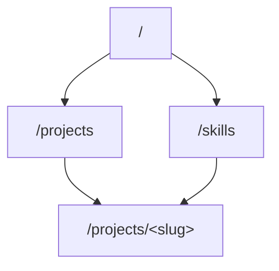
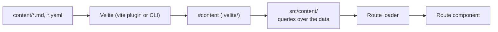

# Architecture

How the application is structured and how new code should fit in. The stack is recorded in [decision 0006](decisions/0006-tanstack-start-application-stack.md), the folder layout in [decision 0009](decisions/0009-feature-folder-structure.md), and the static build with content in the repository in [decision 0019](decisions/0019-static-site-content-in-repo.md).

## Stack and entry points

A TypeScript React app on TanStack Start, prerendered to static HTML at build time: TanStack Router for file-based routes, TanStack Query for client data, the React compiler, Tailwind CSS, and Velite for content. All of it is configured in [../vite.config.ts](../vite.config.ts); Velite's schemas are in `velite.config.ts`.

| File | Owns |
| --- | --- |
| [../src/router.tsx](../src/router.tsx) | `getRouter()`: router plus a fresh QueryClient per request, wired for SSR |
| [../src/routes/__root.tsx](../src/routes/__root.tsx) | HTML document, metadata, stylesheets, scripts, devtools |
| `src/routes/_public/route.tsx` | Public layout: navbar and [site menu](ui.md#site-menu), page outlet, footer, intro curtain, coming-soon redirect |
| [../src/routeTree.gen.ts](../src/routeTree.gen.ts) | Generated from the route files; never edit by hand |
| `velite.config.ts` | Content schemas and cross-file checks ([content](data.md)) |

## Planned routes

Route groups that start with `_` (`_public`) are pathless layouts and do not appear in URLs. Every route is prerendered.

| URL | Route file | Purpose |
| --- | --- | --- |
| `/` | `_public/index.tsx` | Hero, description, 3 featured projects, 3 top skills, contact links, CV download |
| `/projects` | `_public/projects/index.tsx` | All projects that are not drafts |
| `/projects/<slug>` | `_public/projects/$.tsx` | Case study for one project. A splat, so deeper paths 404 inside the layout |
| `/skills` | `_public/skills/index.tsx` | All skills, each linking to its page |
| `/skills/<slug>` | `_public/skills/$slug.tsx` | One skill: its confidence, a tool filter, and the projects that used its tools |
| `/ai`, `/ai/projects`, `/ai/projects/<slug>`, `/ai/skills`, `/ai/skills/<slug>` | `ai/` | The [agent view](decisions/0021-agent-copies-and-agent-view.md) of each page: its agent copy rendered, in its own plain layout (`ai/route.tsx`); `noindex` |
| `/coming-soon` | `coming-soon.tsx` | Holding page while the site is gated; `noindex` |
| `/sitemap.xml` | `sitemap[.]xml.ts` | Server route: the public pages plus every project and skill that is not a draft |
| `/robots.txt` | `robots[.]txt.ts` | Server route: allows crawlers and names the sitemap, or disallows everything while the site is gated |
| `/index.md`, `/projects.md`, `/projects/<slug>.md`, `/skills.md`, `/skills/<slug>.md`, `/llms.txt`, `/sitemap.md` | none: static files | [Agent copies](decisions/0021-agent-copies-and-agent-view.md) and their indexes, written into `public/` by `scripts/agent-files.ts` before each build; none while the site is gated |



There is no admin area and no sign-in ([decision 0019](decisions/0019-static-site-content-in-repo.md)).

## Coming-soon gate

While the site is not ready, public pages redirect to `/coming-soon`. One server environment variable controls the gate, and there is no bypass for the owner:

| `COMING_SOON` | Result |
| --- | --- |
| not `"true"` | Site is public; `/coming-soon` redirects to `/` |
| `"true"` | Public pages redirect to `/coming-soon`; `/sitemap.xml` lists nothing and `/robots.txt` disallows everything |

```ts
// src/features/site/site.utils.ts
export function isSiteGated(comingSoon: string | undefined) {
	return comingSoon === "true";
}

// src/features/site/site.functions.ts
export const getSiteGate = createServerFn().handler(async () => ({
	gated: isSiteGated(process.env.COMING_SOON),
}));

// src/routes/_public/route.tsx
beforeLoad: async () => {
	const { gated } = await getSiteGate();
	if (gated) throw redirect({ to: "/coming-soon" });
},
```

The server reads `COMING_SOON` from its environment, not the client bundle. Vercel applies a changed value only to new deployments, so changing it in Vercel takes a redeploy. The gate is not authentication, and it is removed after launch.

The gate hides pages, not content. Every project that is not a draft ships in the client bundle even while the site is gated, so keep unreleased work as `draft: true` until launch ([content](data.md#drafts)).

## SEO and metadata

`src/features/seo/seo.utils.ts` is the only place that builds page metadata. A route's `head()` calls `buildSeo()` and returns the result; no route writes `og:` or `twitter:` tags by hand.

```ts
head: ({ loaderData }) => {
	const project = loaderData?.page.project;
	if (!project) return {};
	return buildSeo({
		title: project.title, // "Title · wends.dev"; leave out on the home page
		description: truncateDescription(project.description), // at most 160 characters
		path: `/projects/${project.slug}`, // canonical and og:url, on https://portfolio.wends.dev
		image: project.cover, // Velite's relative `/static/…` URL becomes absolute
		type: "article",
		jsonLd: projectJsonLd(project),
	});
},
```

- Every public page has its own title and description. The root route sets site-wide defaults, which the 404 page keeps; a page's own tags replace them.
- The origin is the `SITE_ORIGIN` constant, not an environment variable. Preview deployments are behind a login, so they are never crawled.
- A page without an image sends none and uses the `summary` Twitter card. Set `DEFAULT_SOCIAL_IMAGE` to a 1200×630 file in `public/` to give every page without its own image a `summary_large_image` card.
- `noindex: true` drops the canonical link, `og:url`, and JSON-LD. Error pages set `noindex` themselves ([ErrorPage](../src/features/site/components/ErrorPage.tsx)).
- Every indexable page with a path also gets `<link rel="alternate" type="text/markdown">` to its [agent copy](decisions/0021-agent-copies-and-agent-view.md).
- `/sitemap.xml` and `/robots.txt` read the same Velite content as the pages. While `COMING_SOON` is `"true"`, the sitemap lists nothing and `robots.txt` disallows everything.

## Content flow

Content is files in `content/`. Velite validates them and generates typed data; route loaders import that data directly. There is no database and there are no server functions for content.



- Loaders run at build time during prerendering, and in the browser on client-side navigation, so content is part of the client bundle. Drafts are removed before that unless drafts are switched on ([content](data.md#drafts)).
- Shape and order the data in plain functions next to the generated import (for example `getProjectPage(slug)`), and keep them pure so Vitest can test them without the build.
- Load independent sections in parallel when a loader needs more than one.
- Server functions remain available for anything that truly needs a server, but nothing on the public site does. Any that are added accept same-origin calls only, through the CSRF middleware in [../src/start.ts](../src/start.ts).

## Folder ownership

| Location | Responsibility |
| --- | --- |
| `content/` | The site's content: projects, skills, tools, collaborators, homepage order ([content](data.md)) |
| `src/routes/` | URLs, loaders, page composition |
| `src/content/` | Queries over the generated content data |
| `src/features/<feature>/` | Feature code: `utils`, `types`, `hooks/`, `components/` ([0009](decisions/0009-feature-folder-structure.md)). Client UI stores (zustand) live in `utils/` ([0015](decisions/0015-zustand-for-client-ui-state.md)) |
| `src/components/`, `src/components/ui/` | Shared components and shadcn primitives |
| `src/lib/` | Shared utilities |
| `src/integrations/` | TanStack Query wiring, GSAP setup (`animations/`) |
| `src/styles.css`, `src/styles/` | Global styles and tokens ([ui](ui.md)) |
| `vercel.json` | Vercel settings ([0005](decisions/0005-vercel-deployment.md), [0014](decisions/0014-vercel-deploys-main-and-development-only.md)) |

Expected features: `public` (landing page), `projects`, `skills`, `seo` (metadata, sitemap, and robots), `site` (gate and error pages), and `agent` (agent copies, the `/ai` views, and the Human / Machine toggle).
