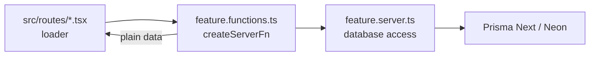

# 0006: TanStack Start as the application stack

Date: 2026-10-05
Status: Accepted

## Context

The portfolio needs server rendering, file-based routes, and server-side data access for the Neon database, all in one TypeScript React codebase. The project was scaffolded with TanStack Start before decision records began; this record captures the owner's reason on 2026-10-05.

## Decision

Use TanStack Start as the application framework because it is the owner's preferred stack. It brings:

| Piece | Role here |
| --- | --- |
| TanStack Start | SSR and server functions (`createServerFn`). Its experimental React Server Components are not used ([0011](0011-no-react-server-components.md)). |
| TanStack Router | File-based routes in `src/routes/`, generated `src/routeTree.gen.ts` |
| TanStack Query | QueryClient per request, wired to the router for SSR in `src/router.tsx` |
| Nitro | Server output: `bun` preset locally, `vercel` on Vercel ([0005](0005-vercel-deployment.md)) |

Configuration lives in [../../vite.config.ts](../../vite.config.ts) (`tanstackStart()`, `nitro()`, React compiler) and [../../src/router.tsx](../../src/router.tsx).

## Alternatives

None were recorded; the choice predates these records and rests on the owner's preference.

## Consequences

- Routes, loaders, and server functions follow TanStack conventions; the folder layout builds on them ([0009](0009-feature-folder-structure.md)).
- Server-only code relies on TanStack Start's import protection, which by default denies `**/*.server.*` files in the client bundle.
- TanStack Start is stable from `@tanstack/react-start` 1.169. Start and Router packages use caret ranges from their first stable versions, so an install never resolves a release candidate. Other `@tanstack/*` dependencies (Query, devtools) still use `latest`, and Nitro 3 is a beta. Upgrades can change behavior; check installed versions before applying version-specific advice.
- Start requires Vite 8. Server functions and middleware validate input with `.validator()`; the release candidate's `.inputValidator()` is removed. See TanStack's [Migrate from the Release Candidate](https://tanstack.com/start/latest/docs/framework/react/migrate-from-release-candidate) guide.

## Validation

On 2026-10-05, `bun --bun run build` passed with the local `bun` preset and with `NITRO_PRESET=vercel`. The installed `@tanstack/start-plugin-core` defines the default client rule `files: ["**/*.server.*"]`. Runtime behavior of every route was not checked.
