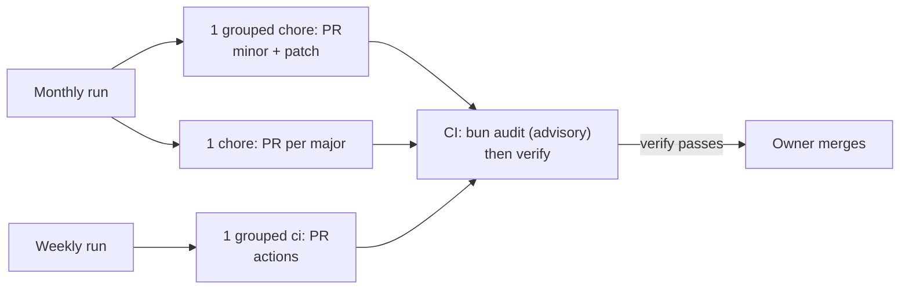

# 0016: Dependabot for dependency and action updates

Date: 2026-10-14
Status: Accepted

## Context

Dependencies in `package.json` and `bun.lock` and the actions pinned in `.github/workflows/*.yml` only change when someone bumps them by hand. Security advisories reach the project only when someone runs `bun audit` locally ([../development.md](../development.md#dependency-overrides)).

## Decision

Dependabot opens the update pull requests; the owner reviews and merges them. [../../.github/dependabot.yml](../../.github/dependabot.yml) defines two version-update streams:

| Ecosystem | Schedule | Pull requests | Commit prefix |
| --- | --- | --- | --- |
| `bun` (`package.json` + `bun.lock`) | Monthly | One grouped PR for every minor and patch update; one PR per major update. At most 5 open. | `chore` |
| `github-actions` (`uses:` lines in workflows) | Weekly | One grouped PR for every action update | `ci` |

Major updates get their own pull request so each changelog can be read and each breaking change verified on its own.

`@types/node` is ignored from version 25: its major must match the Node.js runtime (24, [0005](0005-vercel-deployment.md)), not the newest release. Raise the bound when the runtime changes.

[../../.github/workflows/ci.yml](../../.github/workflows/ci.yml) runs `bun audit` before `verify` on every pull request and every push to `main`, with `continue-on-error: true`. Advisories show in the job log but do not fail the job.

## Alternatives

- **Manual updates only (previous behavior):** nothing prompts an update, and advisories surface only when someone runs `bun audit`.
- **Renovate:** more scheduling and grouping options, but it is a separate GitHub App to install and configure. Dependabot is built into GitHub and reads `bun.lock` directly.
- **Blocking `bun audit`:** an advisory with no published fix, or one deep in a transitive dependency, would fail every pull request until it is fixed upstream.
- **One PR per package:** easier to bisect, but many more pull requests to review and merge for a single-owner repository.

## Consequences

- The owner merges Dependabot PRs when `verify` passes; nothing merges automatically. Read the changelog before merging a major update.
- Dependabot names its branches `dependabot/...`, an exception to the `<type>/<short-name>` rule ([0012](0012-trunk-based-pr-workflow.md)). Its PR titles are conventional commits through the `chore` and `ci` prefixes.
- Workflows triggered by Dependabot cannot read repository secrets. [../../.github/workflows/claude-review.yml](../../.github/workflows/claude-review.yml) skips Dependabot PRs; `ci.yml` needs no secrets. Any new workflow that needs a secret must skip Dependabot PRs too.
- Vercel deploys only `main` and `development` ([0014](0014-vercel-deploys-main-and-development-only.md)), so Dependabot PRs have no preview. `verify` is the only check before merge.
- When the open-PR limit is reached, Dependabot opens no new npm PRs until some are merged or closed.
- `bun audit` never blocks a merge. Fix advisories in their own pull request, through an update or an `overrides` pin ([../development.md](../development.md#dependency-overrides)).
- This file configures version updates only. Dependabot security updates are a separate repository setting.

## Validation

Not verified: the first scheduled runs of each stream, that the `bun` ecosystem reads `bun.lock` as expected, and how the groups and the open-PR limit behave in practice.
