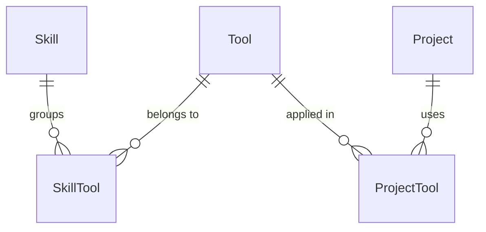

# 0018: Skills group tools

Date: 2026-10-16
Status: Accepted

## Context

[0003](0003-neon-database-and-portfolio-schema.md) named the two levels `SkillCategory` (an area such as Web development) and `Skill` (a technology such as React). The site, however, calls the areas "skills": `/skills` lists them, and the homepage shows "top skills". A model named `SkillCategory` behind a page called skills made every conversation about the data confusing. The owner decided on 2026-10-16 to rename the terms, and that a technology can sit under more than one area (React under Web and Mobile).

## Decision

| Before | After | Meaning |
| --- | --- | --- |
| `SkillCategory` | `Skill` | An area with its own page, confidence and top rank |
| `Skill` | `Tool` | A technology, listed by name |
| `ProjectSkill` | `ProjectTool` | The tools a project used |
| (none) | `SkillTool` | Which tools sit under which skill |

- A tool belongs to any number of skills, or none, through `SkillTool` (composite key, cascade from both sides). `Tool` has no `skillId`.
- A skill page lists the projects that used any of its tools, and filters them by tool.
- `Tool.name` stays unique ignoring case; the index is `tool_name_lower`.
- The code uses the same words: `Skill`, `Tool`, `ProjectTool`, `Project.tools`, and the `skills` and `tools` strings in queries.

## Consequences

- The migration `skill_tool_rename` drops `ProjectSkill`, `Skill` and `SkillCategory` and creates `Skill`, `Tool`, `SkillTool` and `ProjectTool`. The planner does not detect renames, and every table involved was empty, so nothing is copied. With rows in those tables the migration would lose them; do not reuse the approach then.
- Deleting a skill removes its `SkillTool` rows and leaves its tools. This replaces the old rule that a category with skills could not be deleted.

## Validation

`bun --bun run verify` passes. Whether the migration applies cleanly against the database is checked when the owner applies it.
