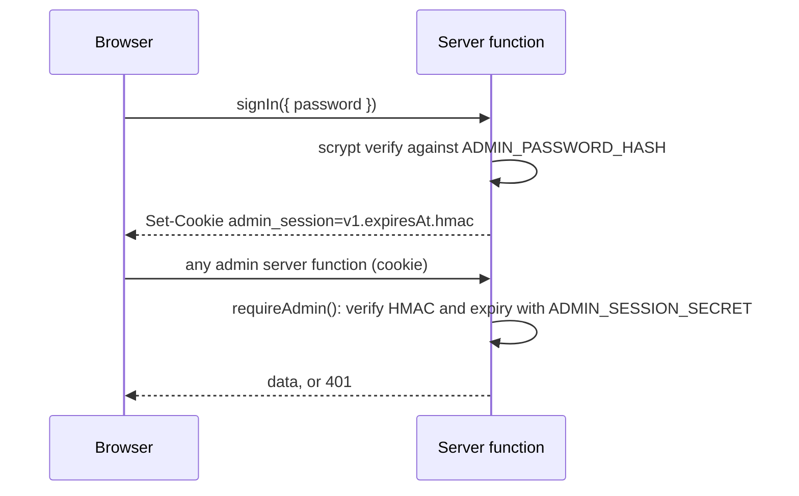

# 0019: Owner password and signed cookie for admin access

Date: 2026-10-17
Status: Accepted

Supersedes [0013](0013-admin-authentication-and-authorization.md).

## Context

The admin dashboard lets the owner create, edit, and delete all content ([intent](../intent.md#admin-dashboard)). Every admin page and every admin server function needs a security boundary (Linear WD-17 sign-in, WD-18 guard).

[0013](0013-admin-authentication-and-authorization.md) proposed Neon Auth (Better Auth) with email/password sign-in and a `neon_auth.user.role = 'admin'` check on every call. On 2026-10-11 the owner chose a simpler design instead, because one person signs in:

- `@neondatabase/auth/server` is a beta toolkit with no TanStack Start adapter, so the app would write and maintain its own.
- The `neon_auth.user` table has no rows and its `role` column has no default, so the owner account and role would also need creating by hand.
- The Neon Auth service is reachable on its own public URL. Not exposing sign-up in the app does not stop anyone calling that URL.

## Decision

**The owner signs in with one password. A valid signed `admin_session` cookie means the owner.** There is no auth provider, no user table, no role, no sign-up, and no 403 state. The app does not read or write the `neon_auth` schema.



| Concern | Decision |
| --- | --- |
| Credentials | `ADMIN_PASSWORD_HASH` holds a scrypt hash in the format `scrypt$<N>$<r>$<p>$<saltB64>$<hashB64>`. `scripts/hash-password.mjs` prompts for a password and prints the value. The plain password is never stored in the repository or an environment variable. |
| Session | The cookie value is `v1.<expiresAt>.<hmac-sha256>`, signed with `ADMIN_SESSION_SECRET` (32 or more random bytes). `HttpOnly`, `Path=/`, `Secure` in production, `SameSite=Strict`, 12-hour expiry. |
| Verification | `src/features/auth/auth.utils.ts` holds the pure functions: `verifyPassword`, `signSession`, `verifySession`, and `safeAdminRedirect`. They do no I/O, so Vitest covers them without a database or a cookie jar. |
| Security boundary | One `requireAdmin()` in `src/features/auth/auth.server.ts`. Every admin server function calls it as its first line. It sets status 401 and throws for a missing, tampered, expired, or wrong-secret cookie. |
| Fail closed | A missing `ADMIN_PASSWORD_HASH` makes sign-in fail. A missing `ADMIN_SESSION_SECRET` makes every session invalid. |
| Route guard | `_dashboard`'s `beforeLoad` calls `getAdminSession()` and redirects signed-out visitors to `/admin/sign-in?redirect=<path>`. It is a UX layer. Server functions are served from `/_serverFn/...`, so a path-based guard never covers them. |
| Sign-in route | `/admin/sign-in` lives outside `_dashboard`, so the redirect cannot loop. It is `noindex`. It follows `redirect` only for `/admin` paths. |
| Failed sign-in | A wrong password waits about one second and returns one generic error. |
| Sign-out | `signOut()` deletes the cookie in the browser. |
| Admin URLs | Everything under `/admin`. |
| Gate | `_dashboard` is outside the coming-soon gate, so the owner can sign in while the public site is gated. |
| Indexing | Admin pages are `noindex`. |
| Config | `ADMIN_PASSWORD_HASH` and `ADMIN_SESSION_SECRET` are server-only variables set per Vercel environment, with placeholders in `.env.example`. |
| Files | `src/features/auth/` follows [0009](0009-feature-folder-structure.md): `auth.utils.ts`, `auth.server.ts`, `auth.functions.ts` (`signIn`, `signOut`, `getAdminSession`), and `components/` for the sign-in form. Admin content features import `requireAdmin` from `auth.server.ts`. |

```ts
// src/features/<feature>/<feature>.functions.ts (intended shape)
export const deleteProject = createServerFn({ method: "POST" })
  .inputValidator(deleteProjectSchema)
  .handler(async ({ data }) => {
    await requireAdmin(); // always the first line
    return deleteProjectById(data.id);
  });
```

## Alternatives

- **Neon Auth with the role check ([0013](0013-admin-authentication-and-authorization.md)).** Rejected: a beta toolkit, a hand-written adapter, and a database lookup on every call, all for one account.
- **GitHub OAuth or magic link.** Rejected for the reasons in 0013: preview origins need callbacks registered, or the mailbox becomes a single point of failure.
- **A guard as server-function middleware instead of a call to `requireAdmin()`.** Rejected: a call at the top of each handler stays visible and is simple to unit test.
- **A server-side session store.** Not needed for one owner. The signed cookie is the whole session, so no table or cache exists.

## Consequences

- No account, role, or `neon_auth` lookup is needed. The guard is a pure signature check.
- Sessions cannot be revoked one at a time. Sign-out clears only the browser's cookie, and a copied cookie stays valid until it expires. Rotating `ADMIN_SESSION_SECRET` signs every session out.
- The password is the only protection against guessing. The one-second delay slows a single client but does not stop parallel requests, so the password must be long and randomly generated. A database-backed lockout or a Vercel WAF rule is a later option.
- There is no password reset in the app. To change the password, generate a new hash and update `ADMIN_PASSWORD_HASH`.
- The `neon_auth` schema stays in the database, and the Neon Auth service stays enabled with the settings it has today (sign-up allowed). The app ignores it, but anyone can still create rows there. Turning the service off or disabling sign-up is a Neon change for the owner to decide.
- Tests cover `verifyPassword`, `signSession` and `verifySession` (valid, tampered, expired, wrong secret, malformed), `safeAdminRedirect`, and `requireAdmin()` for signed-out, invalid-cookie, missing-secret, and owner calls ([0010](0010-vitest-tests-in-every-pr.md)).

### To settle in the implementation pull request

These were raised in review and the owner has not decided them:

- Whether to write `await requireAdmin()` everywhere. If `requireAdmin()` ever becomes async, a call without `await` lets the handler run.
- Whether `verifySession` compares the signature with `timingSafeEqual`.
- Which scrypt cost to use. Node's default `maxmem` is 32 MB, so a high `N` needs `maxmem` raised in both the hash script and `verifyPassword`.
- Whether to use `SameSite=Strict` or `Lax`. With `Strict`, following a link into `/admin` arrives without the cookie, so the sign-in page shows even for a signed-in owner.
- Whether to include a fingerprint of `ADMIN_PASSWORD_HASH` in the signed value, so changing the password also signs out existing sessions.

## Validation

Decision only; no code was run. The Neon Auth facts (empty `neon_auth.user`, no default on `role`, sign-up allowed, trusted origins empty) come from reading the production branch's configuration and schema on 2026-10-12 and 2026-10-17.
