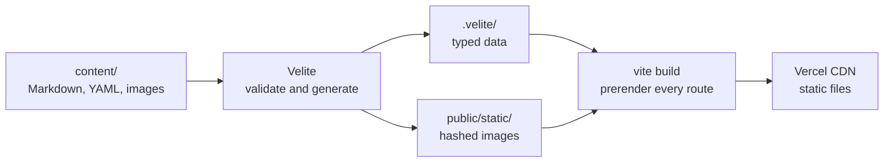

# 0019: Static site, with content in the repository

Date: 2026-10-17
Status: Accepted. Supersedes [0003](0003-neon-database-and-portfolio-schema.md) and [0013](0013-admin-authentication-and-authorization.md), and the object storage part of [0005](0005-vercel-deployment.md#object-storage-client).

## Context

The [intent](../intent.md) planned an admin dashboard with full create, edit, and delete for every content type. That plan needed Neon Postgres ([0003](0003-neon-database-and-portfolio-schema.md)), owner sign-in ([0013](0013-admin-authentication-and-authorization.md)), and an image bucket ([0005](0005-vercel-deployment.md#object-storage-client)). Only placeholder dashboard routes were ever built, and the database holds no real content.

The site has one editor, the owner, and the owner already works in the codebase. On 2026-10-17 the owner decided that a dashboard is more than a personal portfolio needs, and chose to edit content as files instead.

## Decision

**The site is prerendered to static HTML at build time, and its content lives in the repository.** Content changes go through pull requests like code. There is no database, no sign-in, no image bucket, and no admin area.



### Content

[Velite](https://velite.js.org) reads the files in `content/`, validates them against Zod schemas, and writes typed data to `.velite/` and image copies to `public/static/`. Both outputs are generated and gitignored.

```
content/
  site.yaml                  # featured projects and top skills, in order
  tools.yaml                 # every tool name
  collaborators.yaml         # people credited on projects
  projects/<slug>/index.md   # frontmatter + case-study write-up, images beside it
  skills/<slug>.md           # frontmatter + overview
```

```md
---
slug: baconawa-and-eggs
title: Baconawa and Eggs
description: Game made for The Odyssey Festival (2024).
status: ONGOING
startedAt: 2024-09-01
cover: ./cover.png
tools: [Godot]
credits:
  - { collaborator: jane-doe, role: Artist }
draft: false
---
## Problem
…
```

| Concern | Rule |
| --- | --- |
| Formats | Plain Markdown for anything with its own page (projects, skills); YAML for lists (`site.yaml`, `tools.yaml`, `collaborators.yaml`). No MDX until a case study needs an interactive component. |
| Case study | `description` is the one or two sentence summary for lists and link previews. The Markdown body is the write-up (problem, approach, result) and renders on the case study. In the first version the body holds headings, paragraphs, lists, links, and emphasis; images go in `gallery`. |
| Order | Array order in `site.yaml` replaces `featuredRank` and `topRank`. Other projects sort newest first by `startedAt`, which is required. |
| Tools | A tool is known by its name, listed once in `tools.yaml`. Projects and skills reference tools by name, matched ignoring case. |
| Collaborators | Listed once in `collaborators.yaml`; a project's credit references a collaborator by slug and carries its own optional role. |
| Drafts | `draft: true` replaces `published: false`. Drafts appear only when `VITE_SHOW_DRAFTS=true` and are removed from the generated data otherwise, so they never reach a production bundle. A draft listed in `featured` is skipped and the next featured project takes its place. |
| Images | Stored beside their content file and copied with hashed names by Velite. You export images at web size; the schema rejects images wider than 2400px. Every image needs alt text. |
| Validation | Per-file rules live in the Velite schemas. Cross-file rules (unknown tools, collaborators, or featured slugs) live in Velite's `prepare` hook, so a broken reference fails the Vercel build, not only `verify`. |

### Build and serving

| Concern | Rule |
| --- | --- |
| Velite in Vite | A small plugin in `vite.config.ts` runs Velite's `build()` once: watching in `dev`, cleaning in `build`. Scripts that do not start Vite (`typecheck`, `test`, `lint:ds`) run the `velite` CLI first, and so does `postinstall`. |
| Imports | `#content` resolves to the generated `.velite/index.js` through `package.json` `imports`. Route loaders read it directly; there are no server functions for content. |
| Prerender | TanStack Start's `prerender` builds every route to HTML. A post-build check confirms the expected pages exist, because a failed page does not fail the build on its own. |
| Coming-soon gate | `VITE_COMING_SOON=true` at build time redirects public routes to `/coming-soon`. Changing it takes a new deployment. The gate is removed after launch. |
| Adding content | `bun run new:project <slug>` scaffolds a project, and the "adding content" recipe in [AGENTS.md](../../AGENTS.md) lists the steps for people and agents. |

## Alternatives

- **Keep the dashboard and the database.** Rejected: the full CRUD, auth, upload, and edge-case work serves one person who can edit files directly.
- **Keep the database, drop the dashboard.** Content would be edited through seed scripts or the Neon console. Rejected: it keeps migrations, a database connection, and a runtime function for content that changes a few times a year.
- **Content in the repository, still rendered per request.** Rejected: a server function would render the same HTML on every visit, and the runtime gate is the only thing that needs it.
- **Typed `.ts` content files.** No extra dependency, but no Markdown body, and a Git-based CMS could not edit them later.
- **Content Collections instead of Velite.** It has an official Vite plugin, but needs more glue for images and YAML. Velite's built-in image handling, YAML support, and `prepare` hook fit this content; a spike confirmed it works with Vite 8 and TanStack Start.
- **MDX.** Deferred: it compiles to JavaScript, is stricter to write, and nothing needs a component inside the prose yet. Renaming `index.md` to `index.mdx` later keeps the frontmatter and schema.

## Consequences

- Content edits are pull requests. A change goes live after merge plus a build, about a minute or two; git history is the edit log.
- Feature branches do not deploy ([0014](0014-vercel-deploys-main-and-development-only.md)), so new content is previewed locally with drafts on, or on `development` with `VITE_SHOW_DRAFTS=true` scoped to Preview.
- Prisma Next, the `migrations/` folder, the Neon database and Auth, the storage integration, the `_dashboard` routes, and their dependencies and environment variables are removed. The Neon project can be archived afterwards.
- The Vercel deployment becomes static output, so the Node.js runtime setting in [0005](0005-vercel-deployment.md) no longer applies.
- All content ships in the client bundle so loaders can run in the browser on client-side navigation. At this size that is a few kilobytes; revisit if it grows.
- Velite has no official Vite plugin, so the plugin is ours to maintain. If Velite stalls, Content Collections is the fallback.
- Nitro starts the prerender preview server on port 3000 when TanStack Start asks for any free port. Pin the preview host if another local server holds port 3000.
- `og:image` URLs from Velite are relative (`/static/…`); page metadata must make them absolute.
- The edge cases the dashboard was to handle (duplicate slugs, confidence bounds, `endedAt` before `startedAt`, missing alt text) become schema and `prepare` checks.

Work lands in three pull requests: these docs; Velite with the content, the scaffold, and the loader swap (which also closes WD-62); then removing the database and turning on prerendering.

## Validation

A throwaway spike on 2026-10-17, with Velite 0.4.0, Vite 8.3, and the installed TanStack Start, showed:

- Velite produced hashed image copies with width, height, and a blur placeholder, rendered the Markdown body to HTML, and accepted `s.slug()` and `single` collections.
- A `prepare` hook that throws made `bun --bun run build` exit with code 1.
- The plugin rebuilt content on file changes in `dev`; an open page showed the change after a reload.
- Prerendering wrote `/projects/<slug>/index.html` with the title, Open Graph tags, and the hashed cover, and no development markup.
- With `VITE_COMING_SOON=true`, prerendered project paths contained only the coming-soon page.
- Without `.velite/`, `typecheck` and `test` fail on the `#content` import, which is why scripts run Velite first.
- A prerender page failure still exited with code 0 even with `failOnError: true`.

Not yet verified: a full Vercel production build with prerendering, and the `development` preview with drafts on.
