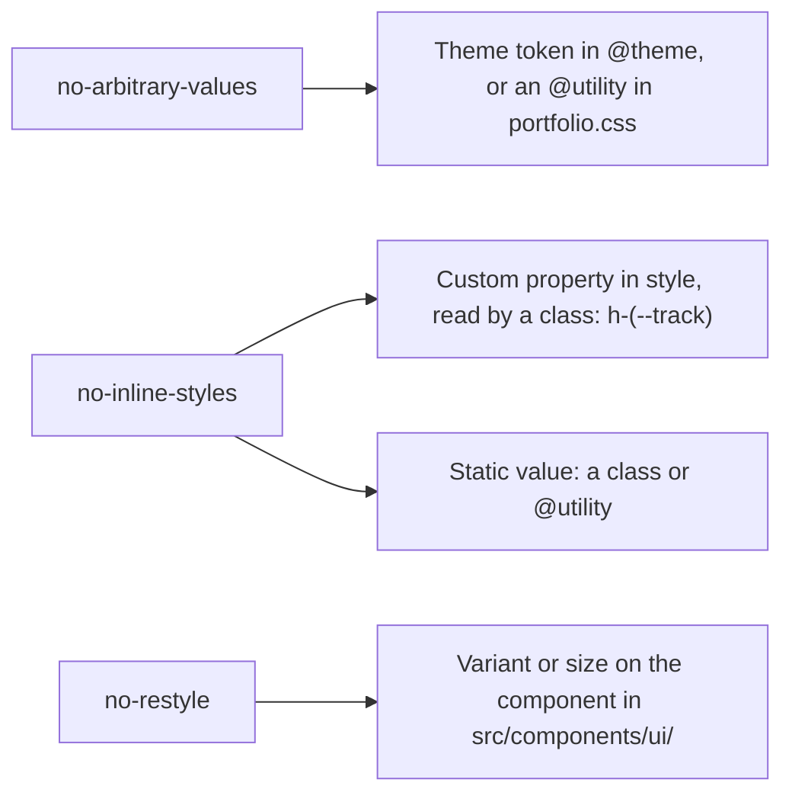

# 0020: Design-system lint rules

Date: 2026-10-19
Status: Accepted

## Context

[0001](0001-oxlint-for-design-system-lint.md) added Oxlint with the `@shadcn/lint` plugin and no rules, and left the choice of rules to the owner. With the public pages built, the candidate rules were run over `src/` to count what each would report.

| Rule | Reports | Before the fix |
| --- | --- | --- |
| `no-arbitrary-values` | Off-scale values such as `p-[13px]` | 24 in 11 files |
| `no-inline-styles` | `style={{ ... }}` and `<style>` | 6 |
| `no-restyle` | `className` overrides on shadcn components | 75; 50 with `allow: ["layout"]` |
| `no-raw-colors` | Raw palette colors such as `bg-pink-500` | 0 |
| `no-unknown-classes` | Classes Tailwind cannot generate | 0 |
| `require-static-classes` | Component classes the linter cannot read | 0 |

## Decision

The owner chose three rules, all at `error`, and chose to fix every existing violation in code rather than allow it.

- `shadcn/no-arbitrary-values`.
- `shadcn/no-inline-styles`.
- `shadcn/no-restyle` with `allow: ["layout"]`, turned off for `src/components/ui/**`, where the primitives are defined.

[../../.oxlintrc.json](../../.oxlintrc.json) also sets `settings.shadcn.note`, which appends a pointer to [UI conventions](../ui.md#design-system-linting) to every diagnostic.

`allow: ["layout"]` is the baseline from the `@shadcn/lint` README. Without it, `mt-6` on a `Button` is an error, which would push every margin into a wrapper element.

Not enabled: `no-raw-colors`, `no-unknown-classes`, and `require-static-classes`. The owner did not select them. They had no violations; a probe file showed `no-raw-colors` flagging `bg-pink-500` and `no-unknown-classes` flagging `rounded-huge`. `require-static-classes` checks only the classes passed to shadcn components. Enabling any of them is one line in `.oxlintrc.json`.

### How violations were fixed

- **Tokens and utilities** in [portfolio.css](../../src/styles/portfolio.css): `--spacing-overhang` and `--spacing-overhang-sm` (the em overhang of a wash box), `--text-2xs`, and `@utility` classes `transition-fade-rise`, `transition-reveal`, `transition-colors-scale`, `grid-rows-fill-auto`, `grid-rows-auto-auto-fill`, `h-svh-third`, `mt-align-display-l` and `wash-hidden`. `--color-secondary-hover` is in [styles.css](../../src/styles.css).
- **Dynamic styles** pass a custom property through `style` and a class reads it: `--track`, `--edge` and `--stagger`. The wash's starting `clip-path` is the `wash-hidden` class. `ThemeToggle` sets `data-transition-name`, and [theme-toggle.css](../../src/styles/theme-toggle.css) maps it to `view-transition-name`.
- **Component variants**: `Button` gains sizes `page` and `page-compact` and variant `outline-rule`; `ProgressValue` gains variant `meta`. The skill list wraps `Progress` in a `div` that carries the fade classes.

## Alternatives

- **Enable all six rules.** Three of them would have cost nothing today, but the owner chose the other three.
- **Disable comments or rule options for existing violations.** Quicker, but it leaves the drift the rules exist to prevent. The owner chose to fix in code.
- **`no-restyle` without `allow: ["layout"]`.** 25 more errors, all spacing and sizing classes on buttons that are placement, not styling.

## Consequences

- Use a `Button` size or variant, or a theme token or `@utility`, instead of a `className` override or an arbitrary value. A treatment that no variant provides becomes a new variant in `src/components/ui/`.
- `delay-(--stagger)` also matches the `delay-*` utility from `tw-animate-css`, so it sets `animation-delay` too. No animation runs on those elements.
- The confidence value in the `/skills` list now uses `type-meta` as designed: 13px from `md`, up from 12px, and each row is about 2px taller. `ProgressValue`'s own `text-xs` used to override it there; `SkillPage` already restated 13px.
- `lint:ds` no longer passes trivially, so 0001's "passes trivially until rules are enabled" no longer holds.
- Oxlint reads `.tsx` only. Class names inside `.css` files are not checked.

## Validation

On 2026-10-19, `bun --bun run lint:ds` exited 0 on `src/`. A probe file with `p-[13px]`, `style={{ color: "red" }}` and `<Button className="rounded-full">` produced one error from each rule, and was deleted. The new utilities and tokens compile and have tests in `tests/styles/portfolio.test.ts` and `tests/lib/utils.test.ts`.

In a dev server on this branch, computed styles matched a dev server of an unchanged checkout for the project page buttons, the landing "Read more" and "See more" links, the scroll track, the cover edge, the hero grid rows and the progress bar. The wash `clip-path` starts hidden from the class. Seeking a paused GSAP timeline moved it to `inset(0%)` and a revert put it back; the confidence value is the one intended difference above.

Not verified: the pick transitions playing in real time (the browser pane was hidden, which pauses animation frames), widths below 768px against the unchanged checkout, and the light theme.
