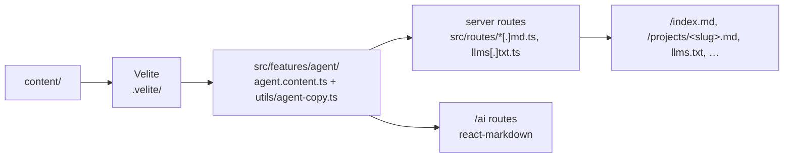

# 0021: Agent copies and the agent view

Date: 2026-10-28
Status: Accepted

## Context

Agents and LLM tools read sites as text. The HTML pages carry the facts (titles, descriptions, tools, dates, links), but inside animated, styled markup an agent has to dig out. The owner wants the site readable by agents and wants people to see that version too ([WD-68](https://linear.app/wends/issue/WD-68), split into [WD-73](https://linear.app/wends/issue/WD-73) and [WD-74](https://linear.app/wends/issue/WD-74)). The owner's decisions from 2026-10-28 are recorded below.

## Decision

### Agent copies (WD-73)

Every page has an **agent copy**: the page as Markdown, built from the same Velite content as the page. Drafts never get one, even with drafts switched on.

| Page | Agent copy |
| --- | --- |
| `/` | `/index.md` |
| `/projects` | `/projects.md` |
| `/projects/<slug>` | `/projects/<slug>.md` |
| `/skills` | `/skills.md` |
| `/skills/<slug>` | `/skills/<slug>.md` |

`/llms.txt` ([llmstxt.org](https://llmstxt.org)) indexes the copies, and `/sitemap.md` lists every page with its URL and copy.



- **Served by server routes, never static files.** Each file has a server route, like `/sitemap.xml`: `src/routes/index[.]md.ts`, `projects[.]md.ts`, `projects/{$slug}[.]md.ts`, `skills[.]md.ts`, `skills/{$slug}[.]md.ts`, `llms[.]txt.ts` and `sitemap[.]md.ts`, all calling `agentFileResponse` in `agent.server.ts`. It sets `text/markdown; charset=utf-8` (`text/plain` for `llms.txt`) and answers 404 for an unknown or draft slug.
  - The owner first chose a script that wrote the files into `public/` before `vite build`. That shipped in #56 and was reverted in #60: Vercel checks static files before the app, and the deployment served the static `index.md` at `/` in place of the home page. Server routes leave nothing in the static output that can stand in for a page, and they work in `dev` too.
- **Same facts as the page.** Each copy starts with the page's title and description, then a **facts block**: a `Field`/`Value` table (status, dates, team, tools, credits, links, metadata). The case study's write-up and the skill's overview follow as the Markdown the owner wrote: Velite keeps it raw beside the HTML (`bodyMarkdown`, `overviewMarkdown`).
- **Absolute links.** Copies link to `https://portfolio.wends.dev`, or to `VITE_SITE_URL` when it is set, so a copy read on its own still points at the site.
- **Each HTML page links its copy** with `<link rel="alternate" type="text/markdown">`. `buildSeo` adds it for every indexable page with a path.
- **The gate hides the files.** With `COMING_SOON=true` every agent file answers 404. The issue named `VITE_COMING_SOON`; the gate's variable is `COMING_SOON` ([architecture](../architecture.md#coming-soon-gate)), so the routes read that one, as `/sitemap.xml` does.
- **No content negotiation.** A request with `Accept: text/markdown` still gets HTML. Agents find the copies through the `<link>`, `llms.txt`, and the `.md` paths.

### Agent view (WD-74)

Every page also has an **agent view** under `/ai`: its agent copy rendered as formatted Markdown for people.

| Page | Agent view |
| --- | --- |
| `/` | `/ai` |
| `/projects` | `/ai/projects` |
| `/projects/<slug>` | `/ai/projects/<slug>` |
| `/skills` | `/ai/skills` |
| `/skills/<slug>` | `/ai/skills/<slug>` |

- **One text, two renderings.** The route loader builds the same string the `.md` file holds, and `react-markdown` with `remark-gfm` renders it, so the view and the file cannot drift. Named links to the site's pages open their agent views; bare URLs, files and other sites keep their addresses.
- **A plain layout.** Mono type on the Light or Graphite theme, and a small header with home, projects, skills and the page's `.md` file. No intro curtain, Lenis, or footer reveal. `/ai` is behind the coming-soon gate, and an unknown path or slug under it shows the 404 page.
- **Kept out of search.** Each view is `noindex`, with a canonical link to its human page and an alternate link to its `.md` file.
- **The Human / Machine toggle.** Two 44px icon links (a person, a robot) in the bottom-right corner of every page, each to the same page in its view; the design is the canvas's A2. An ink block slides under the current view (300ms, `swiss` ease; instant with reduced motion). The toggle is mounted in the root document, outside both layouts, so it survives the route change and the slide plays. It hides on pages without a twin (404, errors, coming soon), while the site menu is open, and while the intro curtain plays.
- The footer has no "For agents" link; the toggle replaces it.

```ts
// src/features/agent/utils/view-paths.ts
getViewTwins("/projects/foo"); // { view: "human", human: "/projects/foo", machine: "/ai/projects/foo" }
getViewTwins("/ai");           // { view: "machine", human: "/", machine: "/ai" }
getViewTwins("/coming-soon");  // null: no toggle
```

## Alternatives

- **Static files written before the build** (a script, or a Vite plugin). Tried first and reverted: a static `index.md` at the root replaced the home page on Vercel, and `projects.md` beside a `projects/` folder risked the same.
- **Serving Markdown on `Accept: text/markdown`.** Deferred; the `.md` paths, the `<link>`, and `llms.txt` cover agents that look for them.
- **Converting the rendered HTML back to Markdown.** Rejected: lossy, and Velite can keep the owner's Markdown as written.
- **Rendering the `/ai` views from the `.md` files at request time.** Rejected: the files do not exist in `dev` or on the client, and building the string in the loader keeps one code path.
- **A toggle inside each layout.** Rejected: the layout changes with the view, so the toggle would remount and the slide could not play.
- **Text labels ("Human", "Machine").** The owner chose icons only (canvas A2); the names stay as accessible names and tooltips.

## Consequences

- Velite's output carries each body twice (HTML and Markdown), so the client bundle grows by the size of the write-ups. At this size that is a few kilobytes.
- `react-markdown` and `remark-gfm` are new dependencies, used only by the `/ai` routes.
- The agent files are built per request by the server function and cached at the edge for an hour (`s-maxage=3600`), like `/sitemap.xml`. Nothing is written into `public/`.
- The TanStack devtools moved to the bottom-left in development, out of the toggle's corner.

## Validation

On 2026-10-28, a build with the Vercel preset had no `.md` file or `llms.txt` in `.vercel/output/static`. A local production build served with Bun returned `/`, `/projects` and every page as HTML, every copy as `text/markdown`, 404 for a draft or unknown slug, `/ai` and its pages with `noindex`, a canonical link and the alternate link, and 404 for an unknown slug under `/ai`. In Chromium the toggle moved between twins by click and by keyboard, hid on 404 pages, while the menu was open, and during the intro curtain, and `/ai/projects` had no horizontal overflow at 390px in Graphite with reduced motion.

Not yet verified: a Vercel deployment of the server routes.
