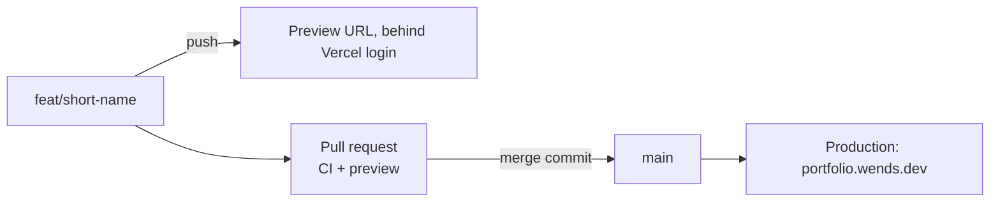

# 0022: Preview every branch; no `develop` branch

Date: 2026-11-05
Status: Accepted
Supersedes: [0014](0014-vercel-deploys-main-and-development-only.md)

## Context

[0012](0012-trunk-based-pr-workflow.md) deferred a `develop` branch and staging URL until after launch (Linear WD-50), on the grounds that every pull request already had its own Vercel preview. [0014](0014-vercel-deploys-main-and-development-only.md) later limited deployments to `main` and `development`, but no `development` branch was ever created. As a result no pull request had a preview, and `main` was the only deployed place to test a change. The site launched on 2026-11-05 (WD-48), so `main` is now public production and can no longer act as staging.

The owner chose on 2026-11-05 to keep the trunk-based workflow and bring back a preview for every branch.

## Decision

Vercel deploys every pushed branch: `main` to production, every other branch to a preview behind Vercel login. There is no `develop` branch and no fixed staging URL. [../../vercel.json](../../vercel.json) has no `git.deploymentEnabled` block, which is Vercel's default:

```json
{
  "installCommand": "bun install --frozen-lockfile",
  "buildCommand": "bun --bun run build"
}
```



## Alternatives

- **`development` branch as staging (0014 as written):** one fixed preview URL for testing merged features together. Rejected: every change needs two merges, the branches drift, and `development` needs its own CI rules and ruleset. A solo owner rarely needs to test several unmerged features together.
- **Keep 0014 without a `development` branch:** no previews at all; every check against a deployed build happens in production. Rejected now that production is public.

## Consequences

- Every pull request, including Dependabot's, gets a preview URL, and builds use more of the Vercel build quota.
- A Preview environment variable applies to every branch unless it is scoped to one. `VITE_SHOW_DRAFTS` set for all of Preview shows drafts on every preview, which stays behind Vercel login.
- To test several changes together, stack their branches ([0012](0012-trunk-based-pr-workflow.md)) and use the top branch's preview.
- Revisit if the build quota runs out or more than one person works on the site.

## Validation

Not verified when this was written: that a push to a `<type>/<short-name>` branch creates a preview, and that the pull request for this change shows one.
