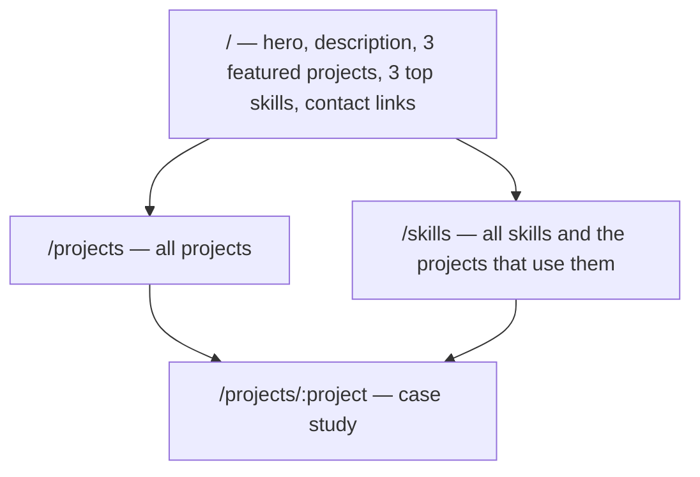

# Product intent

Agreed with the owner: **2026-10-04**. Updated with the owner: **2026-10-17** (no admin dashboard; content in the repository). This document states what the portfolio should become. When the code differs, this document is the direction.

## Purpose

`wends.dev` is a personal showcase. A visitor should be able to confirm experience and stack quickly, then leave or go deeper. Success means credentials are easy to verify without hunting.

The work itself is the proof: projects, the skills they demonstrate, and a downloadable resume. There is no separate experience timeline or certifications section.

## Audience and tone

- **Audience:** primarily the owner, as a showcase of their work. Visitors checking credentials should still find what they need in seconds.
- **Visual direction:** clean and minimal. Typography-led, generous whitespace, restrained color. Use the existing semantic tokens in `src/styles.css`.

## Site structure

| Area | Intent |
| --- | --- |
| Homepage | Hero and description that establish who the owner is, three featured projects, three top skills, contact links, and a resume download |
| Projects | `/projects` lists all projects. Each project has a case-study page covering the problem, approach, and result |
| Skills | Skills such as Web development, each with its tools and the projects that used them |
| Contact | Links only: LinkedIn, GitHub, and email (main and school addresses, main picked by default). No form and no contact backend |
| Resume | A downloadable PDF |
| Content editing | Content lives in the repository and changes by pull request; see [Content editing](#content-editing) |

## Content rules

- **Featured order is manual.** The three featured projects and three top skills are chosen and ordered by hand, not by date or computed ranking.
- **Projects and tools are many-to-many.** A project lists the tools it used; a skill page shows the projects that used any of its tools, filtered by tool. A tool can sit under several skills.
- **Drafts are never public.** A draft project is hidden on the live site, even if it is featured.

## Content editing

Direction from the owner on 2026-10-17: the owner edits content as files in the repository, so the site needs no admin dashboard ([decision 0019](decisions/0019-static-site-content-in-repo.md)). The site is static: pages are built ahead of time and change when a pull request merges.

Adding or editing a project, skill, tool, or collaborator means editing files and opening a pull request. The build rejects invalid content before it ships: duplicate slugs, unknown tools or collaborators, confidence outside 0–100, missing image `alt`, invalid URLs, and `endedAt` before `startedAt`.

## Non-goals

- Blog or long-form writing
- Visitor analytics or tracking
- Internationalization (English only)
- An admin dashboard or any in-browser content editing
- Authentication of any kind: there are no owner or visitor accounts

Changing the content model is significant; record the chosen approach in [decisions](decisions/README.md).

## Answered questions

Answered with the owner on 2026-10-04:

- **Case-study URLs:** a unique `slug` field, so URLs are `/projects/<slug>`.
- **Case-study content:** a `description` field for now; problem, approach, and result fields may come later. On 2026-10-17 the owner chose a Markdown write-up for problem, approach, and result, with `description` kept as the short summary.
- **Resume:** a static file at `public/resume.pdf`, replaced by commit.
- **Skills and tools:** two levels ([0018](decisions/0018-skills-group-tools.md)). A skill (for example Web development, with a 0–100 confidence) groups tools (for example React), and a tool can sit under several skills. Projects link to tools, and the homepage's top skills are skills.
- **Collaborators:** projects can credit a team name and collaborators with optional roles.

Answered with the owner on 2026-10-05:

- **Contact links:** LinkedIn and GitHub only, for now. On 2026-10-11 the owner added email: both addresses are offered, with the main (Gmail) address picked by default.
- **Dark mode:** two themes, Light and Graphite (dark), from the Rence Portfolio design system (Linear WD-43). The site follows the visitor's system setting by default; a toggle in the site menu cycles auto, light and dark, and the browser remembers the choice.
- **Tests:** every pull request that changes behavior includes tests, run with Vitest ([decision 0010](decisions/0010-vitest-tests-in-every-pr.md)).
- **Runtime:** Node.js in production on Vercel; Bun stays the package manager and dev tool. No Bun-only runtime APIs ([decision 0005](decisions/0005-vercel-deployment.md)). Since 2026-10-17 the site is static output ([decision 0019](decisions/0019-static-site-content-in-repo.md)), so no runtime is chosen; Bun stays the tool, and code still avoids Bun-only APIs.
- **React Server Components:** not used for now; server functions return plain data ([decision 0011](decisions/0011-no-react-server-components.md)).

Answered with the owner on 2026-10-17:

- **Admin dashboard and authentication:** dropped. Content lives in the repository and is edited by pull request; the database, sign-in, and image bucket go away ([decision 0019](decisions/0019-static-site-content-in-repo.md)). This replaces the earlier answers on admin authentication (2026-10-04) and admin sign-in (2026-10-08).
- **Drafts:** a `draft` flag replaces publish/unpublish. Drafts show only in local or preview builds with drafts switched on.
- **Collaborators:** listed once and referenced from each project's credits, so a public collaborators feature can come later.

## Open questions

None at the moment. Add new ones here, and answer them with the owner before implementing the affected area.
