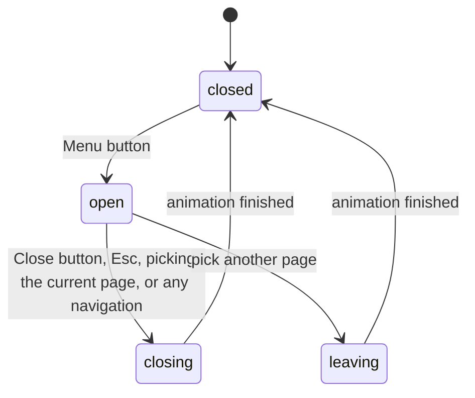
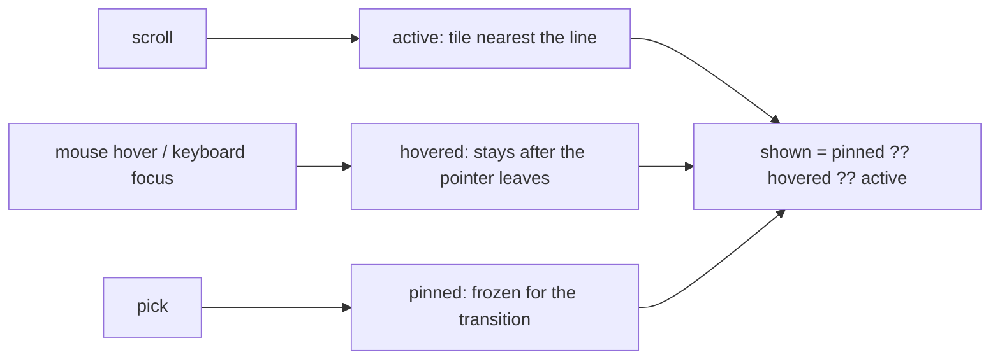

# UI conventions

How to build the interface. shadcn is the component and token base ([decision 0007](decisions/0007-shadcn-component-and-token-base.md)); the portfolio's own design system sits on top ([decision 0002](decisions/0002-portfolio-design-tokens.md)). The visual direction is clean and minimal: typography-led, generous whitespace, restrained color ([intent](intent.md#audience-and-tone)).

## Styles and tokens

1. [../src/styles/portfolio.css](../src/styles/portfolio.css): the Rence Portfolio design system. Light palette (`--ink-black`, `--paper`, `--steel-grey`, `--dim-grey`), semantic roles (`--surface`, `--text`, `--text-muted`, `--rule`, `--focus`…), type scale, fonts, layout utilities.
2. [../src/styles.css](../src/styles.css): the shadcn entry. Its variables point at the portfolio roles (`--background: var(--surface)`, `--primary: var(--surface-accent)`, `--border: var(--rule-soft)`, `--ring: var(--focus)`). Its `.dark` block holds the Graphite palette (`--graphite`, `--graphite-raised`, `--bone`, `--ash`, `--smoke`, `--iron`, `--slate`, `--slate-light`) and re-points the roles to it, so every variable mapped to a role follows.
3. Feature-specific CSS goes in `src/styles/`, for example `intro.css`.

| Need | Use |
| --- | --- |
| Page ground, text, muted text | `bg-background`, `text-foreground`, `text-muted-foreground` |
| Emphasis by inversion | `bg-primary text-primary-foreground`; muted text on that block `text-on-accent-muted` |
| Inversion on an inverse ground (the menu wash) | `bg-inverse-foreground text-inverse` |
| Footer and inverse blocks | `bg-inverse text-inverse-foreground`, secondary text `text-inverse-muted` |
| Hairlines | `border-rule` (primary), `border-rule-soft` (secondary); `border` = 1px, `border-2` = heavy rule |
| Ghost display type (24px+ only) | `text-subtle` |
| Display and reading type | `text-display-xl`, `text-display-l`, `text-display-m`, `text-heading-l`, `text-heading-m`, `text-heading-s`, `text-lead`, `text-body`, `text-body-s` |
| Geist Mono data styles | `type-label` (eyebrows, nav, buttons), `type-meta` (dates, tech lists), `type-index` (counters), or `font-label` |
| Layout | `page-grid` (4 columns on phones, 12 from `md`), `max-w-grid` (1440px) |
| Paragraph first-line indent | `indent-span-N`, where N is the column span of the element: one column plus a gap, so the first line starts on the next grid line (`col-span-4 indent-span-4 md:col-span-8 md:indent-span-8`) |
| Motion | `ease-swiss` with `duration-150`/`200`/`300` |
| Keyboard focus ring | `focus-ring` (2px solid `--focus`, 2px gap, on `:focus-visible` only); on ink add `focus-visible:outline-focus-inverse`; change the gap with `focus-visible:outline-offset-N` |

- `page-grid` sets `--page-gap`, and `indent-span-N` reads it, so the indent always matches the column gap.
- Each `text-*` size token carries line height, tracking, and weight. Display sizes are fluid with `clamp()`; other sizes step up at 768px.
- Spacing uses Tailwind's default 4px scale (`p-4` = 16px).
- Base styles: `body` uses `text-body`; `h1`, `h2`, `h3` use `text-display-l`, `text-heading-l`, `text-heading-m`.
- Use `rounded-none` in portfolio components. The design system is square; shadcn primitives keep their radius.
- When adding a `--text-*` token, also register it in the `font-size` class group in [../src/lib/utils.ts](../src/lib/utils.ts), or `cn()` reads it as a colour class and drops one of the pair. `cn()` comes from the [`cn`](https://github.com/shadcn-ui/cn) package ([decision 0017](decisions/0017-cn-package-for-class-merging.md)); import it from `#/lib/utils`, not from `cn`.
- Use semantic tokens, not raw colors or arbitrary values.
- Give every custom focusable element `focus-ring`. Do not combine `outline-none` with `focus-visible:outline-2`: in Tailwind v4, `outline-none` also sets `--tw-outline-style: none`, and `outline-2` reads that variable, so no ring draws. shadcn primitives keep their own `focus-visible:ring-*` box-shadow ring.
- Values JavaScript needs (durations, eases, scroll distances) live in TypeScript and reach CSS as custom properties, as `PinnedText` and `CoverEdge` do. Values only CSS uses stay in CSS.
- Build every surface for both themes, Light and Graphite (dark) ([intent](intent.md#answered-questions), [decision 0002](decisions/0002-portfolio-design-tokens.md)). Check text contrast in both: 4.5:1, or 3:1 for 24px+ text, rules, focus rings and icons.

## Themes

- Paint with roles, never palette names. `bg-ink`, `text-paper`, `text-steel`, `text-dim` and `var(--ink-black)`-style values stay the same in Graphite; the role utilities and `var(--surface)`-style values follow the theme. A new role needs a light value in `portfolio.css` and a Graphite value in the `.dark` block.
- The theme is the `dark` class on `<html>`. It must sit on `<html>`: the shadcn variables resolve there, so a class lower down would not reach them.
- Never read a resolved colour in JavaScript and write it inline (`getComputedStyle(...).getPropertyValue("--text")` into a GSAP `color` tween): the value freezes and a theme switch leaves it behind. Animate a number and let CSS pick the colours, as `PinnedText` does with `--ink` and the `ink-words` utility.
- Switching lives in [../src/lib/theme.ts](../src/lib/theme.ts):
  - `themeHeadScript` runs inline in `<head>` before first paint. A stored `light` or `dark` choice in localStorage wins; anything else follows `prefers-color-scheme`. It also leaves the choice on `<html>` as `data-theme-choice` (absent for auto); `applyChoice` keeps it in step.
  - `themeStore` (zustand, [0015](decisions/0015-zustand-for-client-ui-state.md)) holds the choice: `auto`, `light` or `dark`. It starts as `auto` on the server and in the first render; `hydrate()` reads the stored choice after hydration and follows system changes while on auto. `cycle()` moves auto → light → dark → auto; auto clears the stored key.
- The toggle is `ThemeToggle`, a text button in two places: the navbar, left of the Menu button, on desktop only; and the site menu's bottom row, bottom right on phones and left of "Esc to close" on desktop. Each click rolls the old label up out of its mask while the new one rises in.
- Anything visible before hydration that depends on the stored choice must come from the head script, not the store: the store says `auto` until `hydrate()` runs. `ThemeToggle` renders all three labels and [../src/styles/theme-toggle.css](../src/styles/theme-toggle.css) shows the one matching `data-theme-choice`, so the label is right from the first paint and the server and client render the same markup.
- A toggle click crossfades the theme with the View Transitions API (`fadeTheme` in `theme.ts`, 500ms with the `swiss` ease, timed by the `::view-transition-*(root)` rules in `src/styles.css`). Browsers without the API, reduced motion, and system changes on auto switch instantly. Each toggle has its own `view-transition-name` (`theme-toggle-nav`, `theme-toggle-menu`; names must be unique on the page), which `theme-toggle.css` sets from the toggle's `data-transition-name` attribute, and `theme-toggle.css` hides its old snapshot, so the label roll is never overlaid by the old frame's label.

Add primitives with the shadcn CLI into `src/components/ui/` and reuse them, such as [button.tsx](../src/components/ui/button.tsx). After any CLI run, diff `src/styles.css` and restore the `var(--role)` lines if the CLI overwrote them. Also restore the project's own `Button` sizes and variants (`page`, `page-compact`, `outline-rule`) and the `ProgressValue` `meta` variant if it overwrote those files.

## Design-system linting

`bun --bun run lint:ds` runs Oxlint with `@shadcn/lint` ([decision 0001](decisions/0001-oxlint-for-design-system-lint.md)). Three rules are errors ([decision 0020](decisions/0020-design-system-lint-rules.md)); see the [rule reference](https://github.com/shadcn-ui/lint/blob/main/README.md#rules).

| Rule | Instead of | Do this |
| --- | --- | --- |
| `no-arbitrary-values` | `p-[13px]`, `transition-[opacity,translate]` | Use a scale value or theme token. If none fits, add a token to `@theme` or an `@utility` in [../src/styles/portfolio.css](../src/styles/portfolio.css). |
| `no-inline-styles` | `style={{ height: x }}` | Set a custom property in `style` and read it with a class: `style={{ "--track": x }}` and `h-(--track)`. A fixed value is a class. |
| `no-restyle` | `<Button className="rounded-none px-4">` | Use a variant or size. A treatment no variant provides becomes a new variant in `src/components/ui/`. Layout classes such as `mt-6` and `w-full` are allowed. |

`no-restyle` is off for `src/components/ui/**`. Changing a rule or adding one is a decision; record it in [decisions](decisions/README.md).

## Homepage plan

Sections live in `src/features/public/components/landing/`. The navbar, footer and site menu sit beside them in `src/features/public/components/`.

| Section | Content |
| --- | --- |
| Hero | Name, role, and a short lead. The owner writes the copy. Revealed after the intro curtain. |
| Description | Who the owner is, in a few sentences |
| Featured projects | 3 projects in `featuredRank` order, each linking to its case study |
| Top skills | 3 skills in `topRank` order, linking to `/skills` |
| Contact | "More of me" heading beside three tiles (LinkedIn, GitHub, résumé download from `public/resume.pdf`) and an email panel: Main/School choice with Main picked by default, a mailto link and a copy button. Links and addresses live in `features/public/utils/contact.ts` |
| Navbar | Fixed top bar: `wends.dev` wordmark linking to `/`, and a Menu button that opens the full-screen menu ([WD-53](https://linear.app/wends/issue/WD-53)). Menu state lives in `menuStore` ([0015](decisions/0015-zustand-for-client-ui-state.md)) |
| Footer | Sits behind the page: the page scrolls up to reveal it. `footer-reveal` (in [../src/styles/footer.css](../src/styles/footer.css)) clips a `footer-reveal-content` child that is fixed to the viewport bottom. Keyboard focus inside it scrolls it into view. |

For every page: check keyboard focus, heading order, image alt text, and small-screen layout.

## Error pages

Not-found and error pages share one template, [ErrorPage](../src/features/site/components/ErrorPage.tsx): a small label, a large lowercase title over a rule, then the path, the explanation, and two actions. The copy and actions for each kind live in `getErrorPageCopy` in [../src/features/site/site.utils.ts](../src/features/site/site.utils.ts).

- The router's `defaultNotFoundComponent` renders the 404, and `defaultErrorComponent` ([RouteErrorPage](../src/features/site/components/RouteErrorPage.tsx)) renders errors.
- Throw `notFound()` from a loader when content doesn't exist. A draft 404s the same way as missing content when drafts are off.
- Unknown URLs fall through to the catch-all `routes/_public/$.tsx`, so the layout's coming-soon gate runs first and the 404 renders inside the layout.
- A server-rendering error returns HTTP 500. An error after the page has loaded in the browser shows the same page; "Try again" calls `router.invalidate()`, which re-runs the loaders.
- An error in the `/_public` layout itself renders without the Navbar, so that page draws its own wordmark (`standalone`).
- Error details show in development only (`getSafeErrorDetail`). In production, [../src/start.ts](../src/start.ts) serializes every `Error` as a generic message, so database and storage messages never reach the page source; function middleware logs the real error on the server.
- Error pages are `noindex`, and the intro curtain does not play on them.

## Smooth scroll

[Lenis](https://github.com/darkroomengineering/lenis) smooths wheel and trackpad scrolling on the public pages.

- [PublicPageLenis](../src/features/public/components/PublicPageLenis.tsx) wraps the public layout in `<ReactLenis root>`, so Lenis scrolls the window and keeps native scroll. It never wraps the page in a transformed element, which would break the fixed footer reveal.
- The options live in `LENIS_OPTIONS` in [../src/features/public/utils/smooth-scroll.ts](../src/features/public/utils/smooth-scroll.ts): touch keeps native scrolling and momentum (`syncTouch: false`), and only the wheel and trackpad are smoothed. Keyboard scrolling stays native.
- Lenis does not run its own loop (`autoRaf: false`). GSAP's ticker calls `lenis.raf()`, and Lenis `scroll` events call `ScrollTrigger.update`, so ScrollTrigger and Lenis share one clock.
- [../src/styles/lenis.css](../src/styles/lenis.css) imports Lenis's stylesheet, which gives the `lenis-stopped` and `lenis-smooth` classes on `html` their effect.
- The layout stops Lenis while the intro curtain plays and starts it again after.
- Lenis honors `prefers-reduced-motion` and falls back to unsmoothed scroll, with instant jumps.
- On every navigation that leaves the page (a link, `router.navigate`, back or forward), `settleLenis` drops any glide still running before the router's scroll restoration moves the page. Without it, a click mid-glide lets Lenis ease the new page back down toward the old target. It uses `stop` and `start`, not `scrollTo(…, { immediate: true })`, which would swallow the router's scroll event. A section transition (WD-51) resets to the top with `lenis.scrollTo(0, { immediate: true, force: true })` while its title card covers the page.
- In-page jumps are plain `<a href="#id">` links, which Lenis glides to (`anchors: true`). `isInPageJump` keeps the navigation settle from cancelling that glide. Don't use the router's `<Link hash>` for them, which scrolls on its own as well. There is no back-to-top control.
- `html` has `scroll-padding-top: var(--navbar-height)` in `portfolio.css`, so every jump (Lenis, native, reduced motion, focus) lands clear of the fixed navbar. Change `--navbar-height` with the navbar's padding or row height.
- Put `data-lenis-prevent` on any nested scrolling container (a sheet, a modal, a wide table), or Lenis captures the wheel before it.

## Intro curtain

A paper curtain plays once per browser tab before the page shows.

- GSAP through [../src/integrations/animations/gsap.ts](../src/integrations/animations/gsap.ts), which registers the plugins and the eases in [eases.ts](../src/integrations/animations/eases.ts). `EASES.swiss` matches `--ease-swiss` in `portfolio.css`; a test keeps them equal.
- An inline head script reads `sessionStorage["intro-seen"]` before paint and sets `data-intro` to `play` or `seen`, so a reload in the same tab skips the intro.
- A counter runs `000` to `100` with a progress bar, then the curtain lifts. Timing constants live in [../src/features/public/utils/intro.ts](../src/features/public/utils/intro.ts).
- While it plays, the page behind is `inert` and scroll is locked, both by CSS and by stopping Lenis ([smooth scroll](#smooth-scroll)).
- Reduced motion fades the curtain instead of sliding it.
- With JavaScript off, the curtain stays hidden. A CSS fallback hides it after 10 seconds if the app never starts.

The hero reveals after the curtain lifts, in [HeroSection](../src/features/public/components/landing/HeroSection.tsx):

- Mark each hero element `data-reveal`. `intro.css` hides it until GSAP shows it, with a 10 second CSS fail-safe that the component cancels when it starts.
- The timeline waits `INTRO_HERO_DELAY` while the curtain plays and starts at once when the intro was already seen.
- The name splits into words, each rising out of its own mask. The other elements fade up in a stagger.
- Reduced motion fades everything in without movement or splitting ([reduced motion](#reduced-motion)).

When changing the intro or the hero reveal, check reload in the same tab, a new tab, reduced motion, JavaScript off, scroll and focus after the curtain, and mobile overflow.

## Site menu

The top bar is fixed at every width: the `wends.dev` wordmark on the left links to `/`, and a **Menu** button on the right opens a full-screen ink menu listing **home**, **skills** and **projects**. Linear [WD-53](https://linear.app/wends/issue/WD-53) holds the spec, the timing table and the owner decisions, and links the design canvas.

- **State:** `menuStore`, a zustand store in [../src/features/public/utils/menu/menu-store.ts](../src/features/public/utils/menu/menu-store.ts) ([0015](decisions/0015-zustand-for-client-ui-state.md)). Its actions guard the transitions: the menu does not reopen while closing, and close, toggle and a second pick are ignored while `leaving`. GSAP timelines call `finish` when they end.
- **Where code goes:** the bar in `Navbar.tsx` and the panel in `components/menu/` (`SiteMenu`, `MenuItem`), both under `src/features/public/components/`; the page list, timing constants and current-page helpers in `utils/menu/menu.ts`.
- **Motion:** through the motion helpers ([reduced motion](#reduced-motion)), with `curtain` for the ink panel and `swiss` for words and washes. Durations live in `MENU_TIMING`. The curtain (600–640ms) and the rising words (720ms) are longer than the 150–300ms used elsewhere; that exception covers the menu and the section transition (WD-51) only.
- **Current page:** the link whose path matches the page exactly gets `aria-current="page"`, and a paper dot marks the current section (the first path segment). Picking the current page only closes the menu; picking **projects** on `/projects/<slug>` navigates to `/projects`.
- **Picking a page:** the other words fade, a paper wash sweeps the chosen word, and the router navigates while the panel covers the screen. The timeline waits for the route, then the curtain lifts. The section transition (WD-51) will read the `leaving` phase to tell a menu pick from other navigation.
- **Content:** no contact links and no resume in the menu. The bottom row holds only the "Esc to close" hint, from `md` up.
- **Accessibility:** the button has `aria-expanded`, `aria-controls` and the name "Open menu" or "Close menu" (phones show only the two lines). The panel is a `nav` labelled "Site". While it is open the page behind is `inert` and Lenis is stopped. Focus moves to the first link on open and back to the button on close; Esc closes. Reduced motion only fades the panel. Touch targets are at least 44px; focus rings use `focus-ring`, with `focus-visible:outline-focus-inverse` on ink.

When changing the menu, check it with the keyboard only, with Esc, with reduced motion, at phone width, with back and forward while it is open, and with a slow route load.

## Pinned text

The description and the end section pin their text in place while its words ink, then the next section (projects, contact) slides over it. Both are [PinnedText](../src/features/public/components/landing/PinnedText.tsx) with their own paragraphs.

- `PinnedText` is a tall runway with a sticky `h-svh` stage inside, the same shape as the projects presentation. It does not use GSAP `pin`, which would wrap the page in a transformed spacer ([smooth scroll](#smooth-scroll)).
- Scroll distances live in [../src/features/public/utils/pinned-text.ts](../src/features/public/utils/pinned-text.ts), in svh and not seconds. One scrubbed timeline reads them as durations (one unit is 1svh of scroll), and the component hands the same numbers to CSS as inline custom properties for the runway and the overlaps. Change them there only: `pinnedTextRunway` keeps the layout and the timeline the same length.
- Phases: the text fades in while the runway reaches up over the end of the previous section (`fadeIn`), the words ink (`fill`), the finished text rests (`hold`), then the next section rises over it. The runway reaches down under that section by `cover`, one viewport, so the stage stays pinned until it fully covers the text.
- The covering section is a `relative z-10 bg-background` wrapper whose first child is [CoverEdge](../src/features/public/components/landing/CoverEdge.tsx): a gradient `edge` tall above its top edge that dissolves the text before the solid edge arrives. Projects and contact both do this.
- The stage is `pointer-events-none`, so the overlap over the previous section never blocks its links.
- Reduced motion: the section is normal flow with the text fully inked, no overlap and no gradient. Every layout class involved is `motion-safe:`.

## Reduced motion

Animate through the helpers in [../src/integrations/animations/motion.ts](../src/integrations/animations/motion.ts), which wrap `appGSAP.matchMedia()`. Each callback runs only while its query matches:

- `matchMotion(({ reduce }) => …)` for an animation with a reduced version, usually a fade in place of movement. Branch on `reduce`.
- `matchFullMotion(() => …)` for an animation that drops entirely under reduced motion. The element stays as rendered.

Create SplitText splits inside the callback, so they revert to plain text when the preference changes or the component unmounts.

## Animation hooks

Classes style; data attributes carry state and hooks:

- Classes are for styling, such as `intro-curtain` and `intro-hero`, which [intro.css](../src/styles/intro.css) styles.
- `data-*` with a value is state: `data-active`, `data-current`, `data-intro`.
- `data-*` with no value is a hook that JavaScript targets: `data-reveal`, `data-menu-word`, `data-menu-dot`, `data-menu-label`, `data-pick-title`, `data-pick-wash`, `data-pick-fade`, `data-intro-label`, `data-intro-progress`.

Find elements by scope:

- A selector string for tween targets, scoped by `useAppGSAP({ scope })`.
- `q = appGSAP.utils.selector(scope)` for arrays of elements.
- `el.querySelector` for one element inside an element you already have.
- `document.*` only for elements outside the component, such as the menu button, which sits outside the menu panel.

## Rolling text

[RollingText](../src/components/RollingText.tsx) rolls its letters on hover: each letter leaves through the top of its mask while a copy rises from below, and rolls back down on leave. The homepage projects heading uses it.

- It is decoration. Never put information or an action behind the hover; phones see the static text.
- SplitText splits the text into masked letters, and each letter carries its copy one full height below itself, so one tween moves both.
- Masks clip only vertically. Display sizes use negative tracking, which makes each letter's box narrower than its glyph, so clipping sideways cuts the letter edges.
- Enter and leave each start a new tween with `overwrite`, so a roll interrupted halfway turns back from where the letters are. `reverse()` would run the ease backwards and the stagger right to left.
- With reduced motion the text is not split and does not move.

## Page entrance

Every page enters the same way, title first ([WD-51](https://linear.app/wends/issue/WD-51), step 5): the title's lines rise out of their masks (720ms, `swiss`), then the rest fades up 16px, 400ms each, 60ms apart. The title card and the 150ms fades between pages come with the rest of WD-51.

- [usePageEntrance](../src/features/public/hooks/usePageEntrance.ts) plays it: mark the `h1` with `data-entrance-title` and each block that should follow with `data-entrance`. They play in document order.
- Timing lives in `ENTRANCE_TIMING` in [utils/entrance.ts](../src/features/public/utils/entrance.ts). After 10 items the stagger stops growing, so long lists don't drag.
- On a tab's first load the entrance waits for the intro curtain (`INTRO_HERO_DELAY`), like the hero.
- [entrance.css](../src/styles/entrance.css) hides both kinds of element until the hook runs, only when JavaScript is on, with the same 10 second fail-safe as the intro.
- The title is split into lines with SplitText while it rises and unsplit afterwards, so it rewraps normally on resize. The masks get padding cancelled by a negative margin so descenders aren't clipped.
- Pass a `key` when the content can change without the route remounting: the case study passes the slug, so "next project" plays the entrance again.
- Reduced motion: everything fades in together, nothing moves.
- A hidden tab runs no animation frames, so the entrance waits and plays when the tab is shown.

## List pick

A list pick is a plain left click on a row that starts a transition: the rest of the stage fades, an ink wash sweeps across the picked title, the title fades, then the router navigates. It covers the landing skill rows, the `/skills` items, a project's "Read more", and the `/projects` tiles ([WD-51](https://linear.app/wends/issue/WD-51)).

- [usePickTransition](../src/features/public/hooks/usePickTransition.ts) owns the timeline. Each section passes the elements to animate and the navigation.
- [WashText](../src/features/public/components/landing/WashText.tsx) draws the wash: an ink box holding a paper copy of the text, hidden by its clip-path. The copy wraps with the text, so titles over several lines wash too.
- `PICK_TIMING` in [utils/pick.ts](../src/features/public/utils/pick.ts) holds the seconds. `isPlainClick` decides which clicks the pick takes; modifier and middle clicks stay normal links.
- Lenis stops for the pick, so scrolling can't change what is on stage, and starts again once the route resolves.
- The card blocks have CSS transitions on opacity; the hook sets `transition: none` first, or each GSAP frame would lag behind.
- [LandingProjectsSection](../src/features/public/components/landing/LandingProjectsSection.tsx) ignores ScrollTrigger updates from the moment of the click, because stopping Lenis fires one more update with a wrong progress.
- Reduced motion: everything fades together in `reducedFade`, then the router navigates.
- If the navigation fails (offline, a failed route load), `followNavigation` in `utils/pick.ts` catches it: the timeline reverts so the list shows again, Lenis restarts, and the section's `onCancel` clears the pick so the visitor can try again.

## Projects pages

The design lives on the canvas's "/projects page" tab, in the ★ boards `ProjectsFlowGrid`, `ProjectsFlowPage` and their phone versions. Code is in `src/features/projects/`.

**`/projects`** ([ProjectsPage](../src/features/projects/components/ProjectsPage.tsx)): a details panel on the left (5 columns, sticky under the navbar) and a tile grid on the right (7 columns: 3 tiles across, 2 below `lg`). Featured projects come first by `featuredRank`, then the rest newest first (`orderProjectsForIndex`).

- [useShownProject](../src/features/projects/hooks/useShownProject.ts) owns which project the panel shows. The scroll line is `INDEX_FOCUS_LINE` in `projects.utils.ts`: the middle of the viewport on wide screens, 30% down the space below the strip on phones.
- Hover is an enhancement, never required, so phones and desktops get the same page: only `pointerType === "mouse"` hovers and only `:focus-visible` focus counts, so touch stays on scroll and tap. The other tiles dim while a mouse is over the grid.
- Every project's details render stacked in one grid cell (`col-start-1 row-start-1`), with only the shown one visible and the rest `inert`, so the panel keeps the tallest one's height and doesn't jump.
- Clicking a tile or "Read more" is a [list pick](#list-pick) whose wash runs on the panel's title, not on the tile.
- Phones: the panel becomes a strip under the navbar (number, title, two lines), featured tiles are full-width cards, and the rest are thumbnail-and-title rows.
- A project without a cover keeps its tile's 3:2 box and shows the [no-cover tile](#no-cover-tile) in it; its number and title under the tile do not change.

**`/projects/<slug>`** ([ProjectCaseStudy](../src/features/projects/components/ProjectCaseStudy.tsx)) follows the canvas's ★ A5 board, which comes from the owner's "Artboard 5 copy":

- The header: the project's number in the margin column (its place in the `/projects` order), the title across 8 columns, and "by <team>" at the right end of the title's last line. No team name, no byline.
- The links as buttons under the title (`ProjectLinkButtons`, live site solid and first), and again at the end beside the next project, so they are there before and after reading.
- The cover on the left (6 columns, 4:3) with the label/value list and the credits under it, and the write-up beside the cover under an "about" line that holds the date and status (`getProjectDateLine`). The three sit in one subgrid block with its own rows from `md`; on phones they stack as cover, write-up, details. Nothing else on the page takes a `row-start-*`: the link buttons render nothing for a project without links, and an element placed by row number would let the gallery or the footer fall into the empty row. A project without a cover keeps the cover's 6 columns and 4:3 box and fills it with the [no-cover tile](#no-cover-tile), so the grid never changes with the images.
- A "tools" list opens the details under the cover, above the label/value list: the first three tools in the project's `tools` order (`splitVisibleTools` in [../src/lib/tools.ts](../src/lib/tools.ts)), one per row, styled like the credits rows. With more than three, the "tools" heading row ends in a **show all N** button (N is the total) that opens the [tools dialog](#tools-dialog); with three or fewer there is no button. The owner orders each project's `tools` by importance, because the case study and the `/projects` panel (with "+N", the same pattern as the skills list) both show only the first three. Phones hide the panel's tools line with the rest of its detail; the case study list shows at every width.
- [ProjectGallery](../src/features/projects/components/ProjectGallery.tsx) is the project's `gallery` only, in file order, one at a time with the alt text as the caption. The cover is never one of them. Slides change instantly; the counter and ‹ › buttons show only with more than one image, and the section is left out with none. The expand button after them (always present, even with one image) opens the [full-screen view](#full-screen-gallery); clicking an image does nothing.
- Credits come from the project's `credits`, named from `content/collaborators.yaml`: one ruled row per person with the role on the right, linked when the person has a profile URL.
- "next project" wraps from the last project to the first.
- The label/value list shows only the `metadata` list (`getMetadataRows`), in file order, never fields that have a place of their own. Values can be text, numbers, booleans, or lists of those. With no rows the list is left out.
- The label/value list is a `grid-cols-subgrid`, so labels and values sit on the page columns (1 + 3 on phones, 2 + 4 from `md`).

### No-cover tile

[ProjectCoverTile](../src/features/projects/components/ProjectCoverTile.tsx) stands in for a missing cover in the case study and on the `/projects` tiles. It fills the box the image would, as a decorative `aria-hidden` block: six column rules (`tile-columns`), the project's number as a display figure sized by the tile's own width (`tile-numeral`), and the status and year in label type. Tiles narrower than 12.5rem drop the status and year and keep the number. The landing section's cover box is not covered by this yet.

### Full-screen gallery

[ProjectGalleryViewer](../src/features/projects/components/ProjectGalleryViewer.tsx) is a Base UI `Dialog` that shows the case study's gallery uncropped. The page's gallery owns the open state and the current image, so closing returns to the slide that was on show.

- **Opening:** the image on show grows from the page's cropped frame into its own shape, fitted to the stage (`viewerStage`, `fitContain` in [projects.utils.ts](../src/features/projects/projects.utils.ts)), while the page darkens and blurs a little (`bg-inverse` at 60%). The frame's own image stays hidden until the flight back lands, so it is never drawn twice. The viewer animates `left/top/width/height` with the Web Animations API on an `object-cover` image, which opens the crop smoothly; it measures the frame when it opens and when it closes.
- **Controls:** the counter and close button, then the arrows, then the caption and dots fade in one after another once the image is moving, and out together and fast. Add a new control the same way: a `fade` class with its own delay. Controls and bars are `pointer-events-none` so a click on empty space closes.
- **Input:** ← and → step, Esc and the close button close, and a swipe (touch and pen only) steps. The arrows sit at the sides from `md` and in a row with the dots on phones. With one image there are no arrows, counter or dots.
- **Scrolling:** the popup carries `data-lenis-prevent`, and the dialog locks the page, so the page behind does not scroll.
- **Reduced motion:** no flight and no fades; the viewer appears and disappears at once.

### Tools dialog

[ProjectToolsDialog](../src/features/projects/components/ProjectToolsDialog.tsx) is the case study's "show all N" button and the Base UI `Dialog` it opens: every tool, in the project's order, in a paper window (`bg-background`, `text-foreground`, `border-rule`, so it follows the theme) over the blurred page. [ProjectToolsGrid](../src/features/projects/components/ProjectToolsGrid.tsx) is the window's grid, four columns from `md` and two on phones, and its scroll area, so it carries `data-lenis-prevent`. The design is the canvas's /projects page, "B2 — open and close animations", animation 3.

- **Opening (the shutter):** a GSAP timeline. The page blurs, a hairline draws across the middle, the window opens up and down from it, then each tool's rule draws left to right and its name follows.
- **Closing:** Esc, the close button and a click outside close the dialog at once, through Base UI's closing phase: `onOpenChange` calls `preventUnmountOnClose()` and plays the same timeline backwards (faster), folding the window back into the line, and the timeline's `onReverseComplete` calls `actionsRef.unmount()`. While it closes, the backdrop and window are `pointer-events-none`, so the page is usable straight away. Opening it again mid-close plays the timeline forwards from where it is. A close before the timeline has moved (still at time 0) skips the reverse and lets Base UI close it, because GSAP never fires `onReverseComplete` for a reverse from the start. Focus returns to the button when the dialog unmounts. The open and close decisions live in `playToolsShutter` and `toolsShutterVars` in [projects.utils.ts](../src/features/projects/projects.utils.ts), so Vitest covers them without a DOM.
- **Reduced motion:** the same flow with a short fade of the page blur and the window; nothing moves.

There are no mocks. Placeholder projects and skills are content files marked `draft: true` ([data.md](data.md#drafts)); preview them with `VITE_SHOW_DRAFTS=true`. Without drafts the routes show their empty state and 404s.
