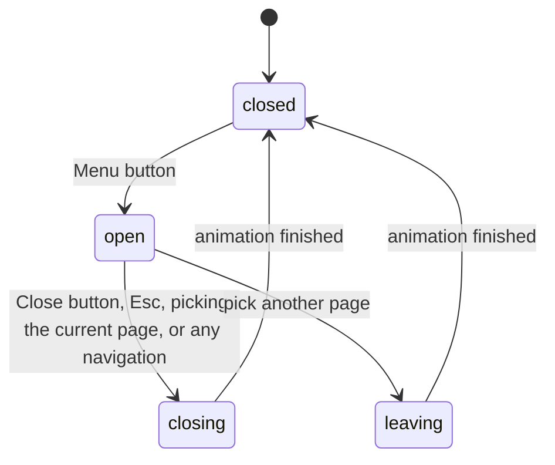

# UI conventions

How to build the interface. shadcn is the component and token base ([decision 0007](decisions/0007-shadcn-component-and-token-base.md)); the portfolio's own design system sits on top ([decision 0002](decisions/0002-portfolio-design-tokens.md)). The visual direction is clean and minimal: typography-led, generous whitespace, restrained color ([intent](intent.md#audience-and-tone)).

## Styles and tokens

1. [../src/styles/portfolio.css](../src/styles/portfolio.css): the Rence Portfolio design system. Palette (`--ink-black`, `--paper`, `--steel-grey`, `--dim-grey`), semantic roles (`--surface`, `--text`, `--text-muted`, `--rule`, `--focus`…), type scale, fonts, layout utilities.
2. [../src/styles.css](../src/styles.css): the shadcn entry. Its light variables point at the portfolio roles (`--background: var(--surface)`, `--primary: var(--surface-accent)`, `--border: var(--rule-soft)`, `--ring: var(--focus)`).
3. Feature-specific CSS goes in `src/styles/`, for example `intro.css`.

| Need | Use |
| --- | --- |
| Page ground, text, muted text | `bg-background`, `text-foreground`, `text-muted-foreground` |
| Emphasis by inversion | `bg-primary text-primary-foreground`, or `bg-ink text-paper` |
| Footer and inverse blocks | `bg-inverse text-inverse-foreground`, secondary text `text-inverse-muted` |
| Hairlines | `border-rule` (primary), `border-rule-soft` (secondary); `border` = 1px, `border-2` = heavy rule |
| Ghost display type (24px+ only) | `text-subtle` |
| Display and reading type | `text-display-xl`, `text-display-l`, `text-display-m`, `text-heading-l`, `text-heading-m`, `text-heading-s`, `text-lead`, `text-body`, `text-body-s` |
| Geist Mono data styles | `type-label` (eyebrows, nav, buttons), `type-meta` (dates, tech lists), `type-index` (counters), or `font-label` |
| Layout | `page-grid` (4 columns on phones, 12 from `md`), `max-w-grid` (1440px) |
| Paragraph first-line indent | `indent-span-N`, where N is the column span of the element: one column plus a gap, so the first line starts on the next grid line (`col-span-4 indent-span-4 md:col-span-8 md:indent-span-8`) |
| Motion | `ease-swiss` with `duration-150`/`200`/`300` |
| Keyboard focus ring | `focus-ring` (2px solid `--focus`, 2px gap, on `:focus-visible` only); on ink add `focus-visible:outline-focus-inverse`; change the gap with `focus-visible:outline-offset-N` |

- `page-grid` sets `--page-gap`, and `indent-span-N` reads it, so the indent always matches the column gap.
- Each `text-*` size token carries line height, tracking, and weight. Display sizes are fluid with `clamp()`; other sizes step up at 768px.
- Spacing uses Tailwind's default 4px scale (`p-4` = 16px).
- Base styles: `body` uses `text-body`; `h1`, `h2`, `h3` use `text-display-l`, `text-heading-l`, `text-heading-m`.
- Use `rounded-none` in portfolio components. The design system is square; shadcn primitives keep their radius.
- When adding a `--text-*` token, also register it in `cn()` in [../src/lib/utils.ts](../src/lib/utils.ts), or `tailwind-merge` may drop it as a colour class.
- Use semantic tokens, not raw colors or arbitrary values.
- Give every custom focusable element `focus-ring`. Do not combine `outline-none` with `focus-visible:outline-2`: in Tailwind v4, `outline-none` also sets `--tw-outline-style: none`, and `outline-2` reads that variable, so no ring draws. shadcn primitives keep their own `focus-visible:ring-*` box-shadow ring.
- Values JavaScript needs (durations, eases, scroll distances) live in TypeScript and reach CSS as custom properties, as `PinnedText` and `CoverEdge` do. Values only CSS uses stay in CSS.
- Build for light mode only for now. The `.dark` block in `src/styles.css` is unused until dark mode is designed ([intent](intent.md#answered-questions)).

Add primitives with the shadcn CLI into `src/components/ui/` and reuse them, such as [button.tsx](../src/components/ui/button.tsx). After any CLI run, diff `src/styles.css` and restore the `var(--role)` lines if the CLI overwrote them.

## Design-system linting

`bun --bun run lint:ds` runs Oxlint with `@shadcn/lint` ([decision 0001](decisions/0001-oxlint-for-design-system-lint.md)). Rules to consider enabling: `no-arbitrary-values`, `no-raw-colors`, `no-unknown-classes`, `no-inline-styles`, `require-static-classes`, and `no-restyle` (turned off for `src/components/ui/**`). See the [rule reference](https://github.com/shadcn-ui/lint/blob/main/README.md#rules). Choosing rules is a design decision; record it in [decisions](decisions/README.md).

## Homepage plan

Sections live in `src/features/public/components/landing/`. The navbar, footer and site menu sit beside them in `src/features/public/components/`.

| Section | Content |
| --- | --- |
| Hero | Name, role, and a short lead. The owner writes the copy. Revealed after the intro curtain. |
| Description | Who the owner is, in a few sentences |
| Featured projects | 3 projects in `featuredRank` order, each linking to its case study |
| Top skills | 3 skill categories in `topRank` order, linking to `/skills` |
| Contact | "More of me" heading beside three tiles (LinkedIn, GitHub, résumé download from `public/resume.pdf`) and an email panel: Main/School choice with Main picked by default, a mailto link and a copy button. Links and addresses live in `features/public/utils/contact.ts` |
| Navbar | Fixed top bar: `wends.dev` wordmark linking to `/`, and a Menu button that opens the full-screen menu ([WD-53](https://linear.app/wends/issue/WD-53)). Menu state lives in `menuStore` ([0015](decisions/0015-zustand-for-client-ui-state.md)) |
| Footer | Sits behind the page: the page scrolls up to reveal it. `footer-reveal` (in [../src/styles/footer.css](../src/styles/footer.css)) clips a `footer-reveal-content` child that is fixed to the viewport bottom. Keyboard focus inside it scrolls it into view. |

For every page: check keyboard focus, heading order, image alt text, and small-screen layout.

## Error pages

Not-found and error pages share one template, [ErrorPage](../src/features/site/components/ErrorPage.tsx): a small label, a large lowercase title over a rule, then the path, the explanation, and two actions. The copy and actions for each kind live in `getErrorPageCopy` in [../src/features/site/site.utils.ts](../src/features/site/site.utils.ts).

- The router's `defaultNotFoundComponent` renders the 404, and `defaultErrorComponent` ([RouteErrorPage](../src/features/site/components/RouteErrorPage.tsx)) renders errors.
- Throw `notFound()` from a loader when content doesn't exist. Unpublished content 404s the same way as missing content.
- Unknown URLs fall through to the catch-all `routes/_public/$.tsx`, so the layout's coming-soon gate runs first and the 404 renders inside the layout.
- A server-rendering error returns HTTP 500. An error after the page has loaded in the browser shows the same page; "Try again" calls `router.invalidate()`, which re-runs the loaders.
- An error in the `/_public` layout itself renders without the Navbar, so that page draws its own wordmark (`standalone`).
- Error details show in development only (`getSafeErrorDetail`). In production, [../src/start.ts](../src/start.ts) serializes every `Error` as a generic message, so database and storage messages never reach the page source; function middleware logs the real error on the server.
- Error pages are `noindex`, and the intro curtain does not play on them.

## Smooth scroll

[Lenis](https://github.com/darkroomengineering/lenis) smooths wheel and trackpad scrolling on the public pages.

- [PublicPageLenis](../src/features/public/components/PublicPageLenis.tsx) wraps the public layout in `<ReactLenis root>`, so Lenis scrolls the window and keeps native scroll. It never wraps the page in a transformed element, which would break the fixed footer reveal.
- The options live in `LENIS_OPTIONS` in [../src/features/public/utils/smooth-scroll.ts](../src/features/public/utils/smooth-scroll.ts): touch keeps native scrolling and momentum (`syncTouch: false`), and only the wheel and trackpad are smoothed. Keyboard scrolling stays native.
- Lenis does not run its own loop (`autoRaf: false`). GSAP's ticker calls `lenis.raf()`, and Lenis `scroll` events call `ScrollTrigger.update`, so ScrollTrigger and Lenis share one clock.
- [../src/styles/lenis.css](../src/styles/lenis.css) imports Lenis's stylesheet, which gives the `lenis-stopped` and `lenis-smooth` classes on `html` their effect.
- The layout stops Lenis while the intro curtain plays and starts it again after.
- Lenis honors `prefers-reduced-motion` and falls back to unsmoothed scroll, with instant jumps.
- On every navigation that leaves the page (a link, `router.navigate`, back or forward), `settleLenis` drops any glide still running before the router's scroll restoration moves the page. Without it, a click mid-glide lets Lenis ease the new page back down toward the old target. It uses `stop` and `start`, not `scrollTo(…, { immediate: true })`, which would swallow the router's scroll event. A section transition (WD-51) resets to the top with `lenis.scrollTo(0, { immediate: true, force: true })` while its title card covers the page.
- In-page jumps are plain `<a href="#id">` links, which Lenis glides to (`anchors: true`). `isInPageJump` keeps the navigation settle from cancelling that glide. Don't use the router's `<Link hash>` for them, which scrolls on its own as well. There is no back-to-top control.
- `html` has `scroll-padding-top: var(--navbar-height)` in `portfolio.css`, so every jump (Lenis, native, reduced motion, focus) lands clear of the fixed navbar. Change `--navbar-height` with the navbar's padding or row height.
- Put `data-lenis-prevent` on any nested scrolling container (a sheet, a modal, a wide table), or Lenis captures the wheel before it.

## Intro curtain

A paper curtain plays once per browser tab before the page shows.

- GSAP through [../src/integrations/animations/gsap.ts](../src/integrations/animations/gsap.ts), which registers the plugins and the eases in [eases.ts](../src/integrations/animations/eases.ts). `EASES.swiss` matches `--ease-swiss` in `portfolio.css`; a test keeps them equal.
- An inline head script reads `sessionStorage["intro-seen"]` before paint and sets `data-intro` to `play` or `seen`, so a reload in the same tab skips the intro.
- A counter runs `000` to `100` with a progress bar, then the curtain lifts. Timing constants live in [../src/features/public/utils/intro.ts](../src/features/public/utils/intro.ts).
- While it plays, the page behind is `inert` and scroll is locked, both by CSS and by stopping Lenis ([smooth scroll](#smooth-scroll)).
- Reduced motion fades the curtain instead of sliding it.
- With JavaScript off, the curtain stays hidden. A CSS fallback hides it after 10 seconds if the app never starts.

The hero reveals after the curtain lifts, in [HeroSection](../src/features/public/components/landing/HeroSection.tsx):

- Mark each hero element `data-reveal`. `intro.css` hides it until GSAP shows it, with a 10 second CSS fail-safe that the component cancels when it starts.
- The timeline waits `INTRO_HERO_DELAY` while the curtain plays and starts at once when the intro was already seen.
- The name splits into words, each rising out of its own mask. The other elements fade up in a stagger.
- Reduced motion fades everything in without movement or splitting ([reduced motion](#reduced-motion)).

When changing the intro or the hero reveal, check reload in the same tab, a new tab, reduced motion, JavaScript off, scroll and focus after the curtain, and mobile overflow.

## Site menu

The top bar is fixed at every width: the `wends.dev` wordmark on the left links to `/`, and a **Menu** button on the right opens a full-screen ink menu listing **home**, **skills** and **projects**. Linear [WD-53](https://linear.app/wends/issue/WD-53) holds the spec, the timing table and the owner decisions, and links the design canvas.

- **State:** `menuStore`, a zustand store in [../src/features/public/utils/menu/menu-store.ts](../src/features/public/utils/menu/menu-store.ts) ([0015](decisions/0015-zustand-for-client-ui-state.md)). Its actions guard the transitions: the menu does not reopen while closing, and close, toggle and a second pick are ignored while `leaving`. GSAP timelines call `finish` when they end.
- **Where code goes:** the bar in `Navbar.tsx` and the panel in `components/menu/` (`SiteMenu`, `MenuItem`), both under `src/features/public/components/`; the page list, timing constants and current-page helpers in `utils/menu/menu.ts`.
- **Motion:** through the motion helpers ([reduced motion](#reduced-motion)), with `curtain` for the ink panel and `swiss` for words and washes. Durations live in `MENU_TIMING`. The curtain (600–640ms) and the rising words (720ms) are longer than the 150–300ms used elsewhere; that exception covers the menu and the section transition (WD-51) only.
- **Current page:** the link whose path matches the page exactly gets `aria-current="page"`, and a paper dot marks the current section (the first path segment). Picking the current page only closes the menu; picking **projects** on `/projects/<slug>` navigates to `/projects`.
- **Picking a page:** the other words fade, a paper wash sweeps the chosen word, and the router navigates while the panel covers the screen. The timeline waits for the route, then the curtain lifts. The section transition (WD-51) will read the `leaving` phase to tell a menu pick from other navigation.
- **Content:** no contact links and no resume in the menu. The bottom row holds only the "Esc to close" hint, from `md` up.
- **Accessibility:** the button has `aria-expanded`, `aria-controls` and the name "Open menu" or "Close menu" (phones show only the two lines). The panel is a `nav` labelled "Site". While it is open the page behind is `inert` and Lenis is stopped. Focus moves to the first link on open and back to the button on close; Esc closes. Reduced motion only fades the panel. Touch targets are at least 44px; focus rings use `focus-ring`, with `focus-visible:outline-focus-inverse` on ink.

When changing the menu, check it with the keyboard only, with Esc, with reduced motion, at phone width, with back and forward while it is open, and with a slow route load.

## Pinned text

The description and the end section pin their text in place while its words ink, then the next section (projects, contact) slides over it. Both are [PinnedText](../src/features/public/components/landing/PinnedText.tsx) with their own paragraphs.

- `PinnedText` is a tall runway with a sticky `h-svh` stage inside, the same shape as the projects presentation. It does not use GSAP `pin`, which would wrap the page in a transformed spacer ([smooth scroll](#smooth-scroll)).
- Scroll distances live in [../src/features/public/utils/pinned-text.ts](../src/features/public/utils/pinned-text.ts), in svh and not seconds. One scrubbed timeline reads them as durations (one unit is 1svh of scroll), and the component hands the same numbers to CSS as inline custom properties for the runway and the overlaps. Change them there only: `pinnedTextRunway` keeps the layout and the timeline the same length.
- Phases: the text fades in while the runway reaches up over the end of the previous section (`fadeIn`), the words ink (`fill`), the finished text rests (`hold`), then the next section rises over it. The runway reaches down under that section by `cover`, one viewport, so the stage stays pinned until it fully covers the text.
- The covering section is a `relative z-10 bg-background` wrapper whose first child is [CoverEdge](../src/features/public/components/landing/CoverEdge.tsx): a gradient `edge` tall above its top edge that dissolves the text before the solid edge arrives. Projects and contact both do this.
- The stage is `pointer-events-none`, so the overlap over the previous section never blocks its links.
- Reduced motion: the section is normal flow with the text fully inked, no overlap and no gradient. Every layout class involved is `motion-safe:`.

## Reduced motion

Animate through the helpers in [../src/integrations/animations/motion.ts](../src/integrations/animations/motion.ts), which wrap `appGSAP.matchMedia()`. Each callback runs only while its query matches:

- `matchMotion(({ reduce }) => …)` for an animation with a reduced version, usually a fade in place of movement. Branch on `reduce`.
- `matchFullMotion(() => …)` for an animation that drops entirely under reduced motion. The element stays as rendered.

Create SplitText splits inside the callback, so they revert to plain text when the preference changes or the component unmounts.

## Animation hooks

Classes style; data attributes carry state and hooks:

- Classes are for styling, such as `intro-curtain` and `intro-hero`, which [intro.css](../src/styles/intro.css) styles.
- `data-*` with a value is state: `data-active`, `data-current`, `data-intro`.
- `data-*` with no value is a hook that JavaScript targets: `data-reveal`, `data-menu-word`, `data-menu-dot`, `data-menu-label`, `data-pick-title`, `data-pick-wash`, `data-pick-fade`, `data-intro-label`, `data-intro-progress`.

Find elements by scope:

- A selector string for tween targets, scoped by `useAppGSAP({ scope })`.
- `q = appGSAP.utils.selector(scope)` for arrays of elements.
- `el.querySelector` for one element inside an element you already have.
- `document.*` only for elements outside the component, such as the menu button, which sits outside the menu panel.

## Rolling text

[RollingText](../src/components/RollingText.tsx) rolls its letters on hover: each letter leaves through the top of its mask while a copy rises from below, and rolls back down on leave. The homepage projects heading uses it.

- It is decoration. Never put information or an action behind the hover; phones see the static text.
- SplitText splits the text into masked letters, and each letter carries its copy one full height below itself, so one tween moves both.
- Masks clip only vertically. Display sizes use negative tracking, which makes each letter's box narrower than its glyph, so clipping sideways cuts the letter edges.
- Enter and leave each start a new tween with `overwrite`, so a roll interrupted halfway turns back from where the letters are. `reverse()` would run the ease backwards and the stagger right to left.
- With reduced motion the text is not split and does not move.

## List pick

A list pick is a plain left click on a row that starts a transition: the rest of the stage fades, an ink wash sweeps across the picked title, the title fades, then the router navigates. It covers the landing skill rows and a project's "Read more" ([WD-51](https://linear.app/wends/issue/WD-51)).

- [usePickTransition](../src/features/public/hooks/usePickTransition.ts) owns the timeline. Each section passes the elements to animate and the navigation.
- [WashText](../src/features/public/components/landing/WashText.tsx) draws the wash: an ink box holding a paper copy of the text, hidden by its clip-path.
- `PICK_TIMING` in [utils/pick.ts](../src/features/public/utils/pick.ts) holds the seconds. `isPlainClick` decides which clicks the pick takes; modifier and middle clicks stay normal links.
- Lenis stops for the pick, so scrolling can't change what is on stage, and starts again once the route resolves.
- The card blocks have CSS transitions on opacity; the hook sets `transition: none` first, or each GSAP frame would lag behind.
- [LandingProjectsSection](../src/features/public/components/landing/LandingProjectsSection.tsx) ignores ScrollTrigger updates from the moment of the click, because stopping Lenis fires one more update with a wrong progress.
- Reduced motion: everything fades together in `reducedFade`, then the router navigates.
- If the navigation fails (offline, a failed route load), `followNavigation` in `utils/pick.ts` catches it: the timeline reverts so the list shows again, Lenis restarts, and the section's `onCancel` clears the pick so the visitor can try again.
